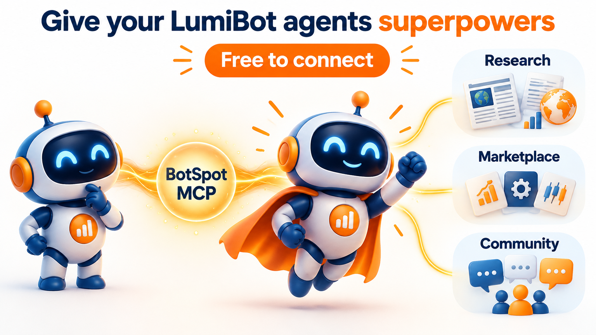

<!-- entry-source-sha256: 7e4b9f55cd1699da8c65e25a9decaff4608e9ba1e7bf7bc06e5ffb5bcca95206 -->

# LumiBot AI Trading

[English](README.md) · [中文](README.zh-CN.md) · [Español](README.es.md) · [Français](README.fr.md) · [Deutsch](README.de.md) · **日本語** · [한국어](README.ko.md) · [Português](README.pt.md) · [Русский](README.ru.md)

**AI トレーディングエージェントを作り、バックテストし、同じ戦略で取引する。**

LumiBot は無料のオープンソース Python フレームワークです。Python のルール、AI エージェントの判断、または両方を組み合わせて取引ボットを作れます。過去データで検証し、判断と取引を確認して、模擬取引や実取引のブローカーに接続できます。

このページは英語 README とドキュメントのホームページの要約です。完全なコードは [英語 README](README.md) と [ドキュメント](https://lumibot.lumiwealth.com/) にあります。

## LumiBot を選ぶ理由

- **ネイティブな AI 取引：** プロンプトに基づき、エージェントが調査、推論、発注を行います。
- **取引前にバックテスト：** AI の判断と Python ルールを過去データで評価し、チャート、取引、ログを確認できます。
- **検証と取引で同じ戦略を使用：** 戦略クラスを維持し、データソースとブローカーの実行設定を変更します。
- **複数の資産クラス：** [対応ブローカー](https://lumibot.lumiwealth.com/brokers.all.html) に応じて、株式、オプション、先物、外国為替、暗号資産、予測市場に対応します。
- **判断をブローカーに届けます。** 注文、約定、判断の記録を確認できます。[実行の仕組み](https://lumibot.lumiwealth.com/execution_gap.html).

## BotSpot MCP で構築を効率化

アシスタントを無料で接続すると、LumiBot の戦略構築スキル、調査データ、バックテストとデプロイのツールを利用できます。[利用できる機能を見る](#ai-アシスタントを接続)。

## エージェントにスーパーパワーを。接続は無料

LumiBot戦略にBotSpot MCPを接続すると、経済データ、ニュース、SEC文書、Marketplaceの戦略、Communityの知識を利用できます。



すでにアシスタントをBotSpotに接続していますか？「このLumiBotプロジェクトをBotSpot MCPに接続して」と伝えてください。アシスタントがAPIキーを作成し、設定を保存できます。

**[エージェントを接続する](https://lumibot.lumiwealth.com/botspot_mcp.html)**

## 戦略を作る 3 つの方法

1. **[AI ネイティブ戦略](README.md#run-your-first-ai-backtest)：** 取引エージェントのプロンプトを編集します。
2. **[Python 戦略](README.md#backtest-a-strategy)：** ルールを Python で記述します。
3. **[ハイブリッド戦略](README.md#build-a-hybrid-strategy)：** Python ルールと AI の判断を組み合わせます。

## はじめに

Python 3.10 以降が必要です。無料の日足データを使うサンプルのバックテストを実行できます。

```bash
pip install lumibot
lumibot demo
```

AI の例にはモデルの認証情報が必要で、呼び出しには料金がかかる場合があります。模擬取引や実取引にはブローカー口座と認証情報が必要です。[AI の例](README.md#run-your-first-ai-backtest)、[CLI 設定](https://lumibot.lumiwealth.com/cli.html)、[実行モード](https://lumibot.lumiwealth.com/strategy_run_modes.html) を参照してください。バックテストは将来の成績を保証しません。

## AI アシスタントを接続

Claude、ChatGPT、Codex、Cursor、VS Code、または他の MCP 対応アシスタントを利用できます。コーディングアシスタントはコードの作成とテストを支援し、戦略内のエージェントは実行時の取引判断を行います。

BotSpot MCP では戦略構築スキル、無料の調査データ、チャート付きバックテスト、定期的なクラウド実行、コミュニティ、マーケットプレイス、ブローカー口座の接続を利用できます。接続は無料です。ホストされた機能の利用条件はプランによって異なります。

**[AI アシスタントを接続](https://botspot.trade/agents)**

ローカルでのコーディング支援には無料の [LumiBot トレーディングスキル](https://github.com/Lumiwealth/lumibot-trading-skills) を利用できます。戦略内の調査ツールは [BotSpot MCP ガイド](https://lumibot.lumiwealth.com/botspot_mcp.html) を参照してください。

## フレームワークを調べる

[Python の例](https://lumibot.lumiwealth.com/examples.html) · [AI の例](https://lumibot.lumiwealth.com/agents_examples.html) · [Strategy API](https://lumibot.lumiwealth.com/strategy_api_overview.html) · [ブローカー](https://lumibot.lumiwealth.com/brokers.all.html)

取引には損失のリスクがあります。過去のシミュレーションは利益を保証しません。
