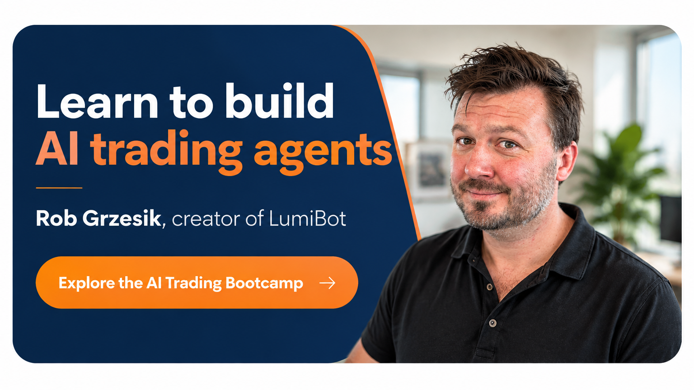

[](https://github.com/Lumiwealth/lumibot/actions/workflows/cicd.yaml)
[](https://github.com/Lumiwealth/lumibot/actions/workflows/cicd.yaml)
[](https://pypi.org/project/lumibot/)
[](https://pypistats.org/packages/lumibot)
[](https://pypi.org/project/lumibot/)
[](LICENSE)

# LumiBot AI Trading

**Build AI trading agents. Backtest them. Trade with the same strategy.**

LumiBot is a **free, open-source Python framework** for building trading bots.
Write your own trading rules, let AI agents make decisions, or combine both.
Backtest on historical data, inspect trades and results, and use the same
strategy class with a supported broker for paper or live trading.

**Full docs:** [lumibot.lumiwealth.com](https://lumibot.lumiwealth.com/?utm_source=github&utm_medium=readme&utm_campaign=lumibot&utm_content=top_docs_link) · **Managed cloud:** [BotSpot.trade](https://botspot.trade/sales?showLogin=1&utm_source=github&utm_medium=readme&utm_campaign=lumibot&utm_content=top_text_link&sample=lumibot_readme_deploy) · **MCP:** [BotSpot for AI coding agents](https://botspot.trade/agents?utm_source=github&utm_medium=readme&utm_campaign=lumibot&utm_content=top_mcp_link)

Read this in [中文](README.zh-CN.md) · [Español](README.es.md) · [Français](README.fr.md) · [Deutsch](README.de.md) · [日本語](README.ja.md) · [한국어](README.ko.md) · [Português](README.pt.md) · [Русский](README.ru.md)

## Why LumiBot?

- **Native AI trading:** agents research, reason and place orders from your prompts.
- **Backtest before trading:** evaluate AI decisions and Python rules on historical data, with charts, trades and logs.
- **Same strategy for backtesting and trading:** keep your strategy class; change the data source and broker runner.
- **Multiple asset classes:** stocks, options, futures, forex, crypto and prediction markets through [supported brokers](https://lumibot.lumiwealth.com/brokers.all.html).
- **The decision reaches a broker.** Inspect the orders, fills and decision records. [How execution works](https://lumibot.lumiwealth.com/execution_gap.html).

## Connect your AI assistant

**Build faster with BotSpot MCP.** Claude, ChatGPT, Codex, Cursor, VS Code or
another MCP-compatible assistant can help you write and test LumiBot strategies.
Your coding assistant builds the code; the agents **inside** an AI-native
strategy make its trading decisions while it runs.

Connect the free [BotSpot MCP](https://botspot.trade/agents?utm_source=github&utm_medium=readme&utm_campaign=lumibot&utm_content=top_mcp_free) for:

- **Skills:** build LumiBot strategies.
- **Free data:** news, economics and SEC filings.
- **Backtests:** run tests and inspect charts, trades and logs.
- **Cloud hosting:** run bots on a schedule.
- **Community:** share ideas and learn from other builders.
- **Marketplace:** discover and publish strategies.
- **Broker linking:** connect accounts through BotSpot.

**[Connect your AI assistant](https://botspot.trade/agents)**

Connecting is free; hosted usage depends on your plan.
For local coding help, install the free [LumiBot trading skills](https://github.com/Lumiwealth/lumibot-trading-skills).
Your running strategy's agents can get research tools too:
[give them BotSpot MCP superpowers](#strategy-botspot-research).

## Three ways to build a strategy

- **[AI-native strategies](#run-your-first-ai-backtest):** write prompts for trading agents.
- **[Python strategies](#backtest-a-strategy):** write your rules in Python.
- **[Hybrid strategies](#build-a-hybrid-strategy):** combine Python rules and AI decisions.

## Run your first AI backtest

**The trading rules go in the prompt.** Edit `system_prompt` below to change
what the agent does. `initialize()` creates it once; `on_trading_iteration()`
calls it on every iteration. This example has one agent that makes the trading
decisions and places orders.

Use Python 3.10+. This example uses Yahoo daily prices and an OpenAI model;
model calls incur charges.

```bash
pip install lumibot
export OPENAI_API_KEY="your-openai-api-key"
```

Save as `my_ai_strategy.py`:

```python
from datetime import datetime
from lumibot.backtesting import YahooDataBacktesting
from lumibot.strategies import Strategy


class MyAIStrategy(Strategy):
    def initialize(self):
        self.sleeptime = "1D"
        self.agents.create(
            name="trader",
            default_model="openai/gpt-6-luna",
            reasoning_effort="medium",
            allow_trading=True,
            system_prompt=(
                "Trade SPY using its last 20 completed daily bars. "
                "Buy when the latest completed close is above their average; "
                "sell an existing position when it is below. Otherwise hold. "
                "Keep the position at or below 10% of portfolio value. "
                "Check cash, positions and open orders before acting. "
                "No shorting or leverage. Do not duplicate pending orders. "
                "Use only information available as of the strategy time."
            ),
        )

    def on_trading_iteration(self):
        self.agents["trader"].run(
            task_prompt="Review SPY, apply your rules and verify any orders.",
            context={"as_of": self.get_datetime().isoformat()},
        )


if __name__ == "__main__":
    MyAIStrategy.backtest(
        YahooDataBacktesting,
        datetime(2026, 4, 6),
        datetime(2026, 4, 11),
        budget=100_000,
        benchmark_asset="SPY",
    )

```

```bash
python my_ai_strategy.py
```

Review the decisions, orders and backtest charts. This demonstrates the API;
it is not a claim that this trading rule is profitable.

For a complete two-agent team, [read the researcher-and-trader example](lumibot/example_strategies/ai_researcher_trader.py) and [follow its walkthrough](https://lumibot.lumiwealth.com/agents_quickstart.html):

```bash
python -m lumibot.example_strategies.ai_researcher_trader
```

**Recorded run (made with Gemini):** the existing two-agent example has [source, decisions and trade records](docs/assets/ai-trading/spy-20260913/README.md). These are historical results, separate from the single-agent example above.

<a id="strategy-botspot-research"></a>

### Give your agents superpowers—for free

**Add BotSpot MCP to your LumiBot strategy.** Your AI agents get economic data,
news and SEC documents, Marketplace strategies and Community knowledge through
one free connection.

<p align="center">
  
</p>

Already connected BotSpot to Codex, Claude Code or Cursor? Tell it:
**“Connect this LumiBot project to BotSpot MCP.”** It can create the key and save
the settings for you. **[Give your agents superpowers](https://lumibot.lumiwealth.com/botspot_mcp.html)**.

Or connect from the directory containing `my_ai_strategy.py`:

```bash
lumibot connect botspot
python my_ai_strategy.py
```

Approve the BotSpot sign-in when prompted. The connection saves
`BOTSPOT_RESEARCH_MCP_URL` and `BOTSPOT_RESEARCH_MCP_TOKEN` in your project's
`.env`. LumiBot loads them and attaches research tools **automatically** when
`self.agents.create(...)` creates an agent. Keep that file out of Git.

Tell the agent what to research. For example, add this to its `system_prompt`:

```text
Use BotSpot research tools to find evidence relevant to this strategy.
Cite sources and dates, explain data gaps, and use only information
available at the strategy time.
```

The [connection guide](https://lumibot.lumiwealth.com/botspot_mcp.html) explains
assistant-led setup, manual key settings and available research tools.

## Backtest a strategy

This is a traditional rules-based strategy: buy 10 AAPL shares on the first iteration and hold. It uses Yahoo historical prices, requires internet access, and makes no AI calls. Use Python 3.10 or later.

```bash
pip install lumibot
```

Save this as `my_strategy.py`:

```python
from datetime import datetime
from lumibot.strategies import Strategy
from lumibot.backtesting import YahooDataBacktesting

class MyStrategy(Strategy):
    def on_trading_iteration(self):
        if self.first_iteration:
            aapl = self.create_order("AAPL", 10, "buy")
            self.submit_order(aapl)

MyStrategy.backtest(
    YahooDataBacktesting,
    datetime(2023, 1, 1),
    datetime(2024, 1, 1),
)
```

```bash
python my_strategy.py
```

## Build a hybrid strategy

Use Python for the rules you want to control directly and an agent for the
research or decision you want it to handle. A moving-average entry can trigger
a read-only risk review; Python checks the structured answer, sizes the
position and submits the order. Set that reviewer's `allow_trading=False`.
[See the hybrid flow](https://lumibot.lumiwealth.com/agents_flows.html) and
[structured-answer examples](https://lumibot.lumiwealth.com/agents_quickstart.html).

## Run the same strategy with a paper broker

After the backtest works, keep the `MyStrategy` class and replace the final `MyStrategy.backtest(...)` call with a broker runner. This example uses Alpaca paper trading:

```bash
export ALPACA_API_KEY='your-alpaca-key'
export ALPACA_API_SECRET='your-alpaca-secret'
export ALPACA_IS_PAPER=true
python my_strategy.py
```

```python
import os
from lumibot.brokers import Alpaca
from lumibot.traders import Trader

ALPACA_CONFIG = {
    "API_KEY": os.environ["ALPACA_API_KEY"],
    "API_SECRET": os.environ["ALPACA_API_SECRET"],
    "PAPER": os.environ.get("ALPACA_IS_PAPER", "true").lower() != "false",
}

broker = Alpaca(ALPACA_CONFIG)
strategy = MyStrategy(broker=broker)

trader = Trader()
trader.add_strategy(strategy)
trader.run_all()
```

Start with paper trading. When you are ready for live trading, use the same strategy class and switch your broker account/configuration intentionally.

For full setup guides, broker tutorials, AI-agent docs, examples, and deployment notes, use the **[Lumibot documentation](https://lumibot.lumiwealth.com/)**.

## Explore LumiBot

- [Python strategies](https://lumibot.lumiwealth.com/examples.html) and [AI strategies](https://lumibot.lumiwealth.com/agents_examples.html)
- [Strategy API](https://lumibot.lumiwealth.com/strategy_api_overview.html), [data sources](https://lumibot.lumiwealth.com/backtesting.html) and [brokers](https://lumibot.lumiwealth.com/brokers.all.html)
- [Compare frameworks](https://lumibot.lumiwealth.com/ai_trading_project_comparison.html) and [migrate from Backtrader](docsrc/MIGRATING_FROM_BACKTRADER.rst)
- [CLI setup](https://lumibot.lumiwealth.com/cli.html), including `lumibot demo` and `lumibot init`
- [Run locally or deploy](https://lumibot.lumiwealth.com/deployment.html) and [cash accounting](https://lumibot.lumiwealth.com/cash_accounting.html)

## Want help building your first AI trading bot?

**[Join the free challenge](https://botspot.trade/challenges?utm_source=github&utm_medium=readme&utm_campaign=lumibot_ai_trading&utm_content=free_challenge)** with Rob Grzesik, creator of LumiBot. Follow the training and learn how to turn an idea into an AI trading strategy.

<p align="center">
<a href="https://botspot.trade/challenges?utm_source=github&utm_medium=readme&utm_campaign=lumibot_ai_trading&utm_content=free_challenge_image"></a>
</p>

Looking for deeper training? [Explore the AI Trading Bootcamp](https://botspot.trade/courses/ai-trading-bootcamp?utm_source=github&utm_medium=readme&utm_campaign=lumibot_ai_trading&utm_content=bootcamp). Prefer a hosted workspace? [Explore BotSpot](https://botspot.trade/agents?utm_source=github&utm_medium=readme&utm_campaign=lumibot_ai_trading&utm_content=hosted).

<p align="center">
  <strong>🌐 Community</strong><br><br>
  <a href="https://www.reddit.com/r/BotSpotTrade/"> Reddit Community</a>
  &nbsp;&nbsp;&nbsp;
  <a href="https://discord.gg/4R9j6T3PN8"> Discord Community</a>
</p>


## Project Growth

<a href="https://www.star-history.com/?repos=Lumiwealth%2Flumibot&type=date&legend=top-left">
 <picture>
   <source media="(prefers-color-scheme: dark)" srcset="https://lumibot-star-history.lumiwealth.workers.dev/chart.svg?theme=dark&amp;v=20260802" />
   <source media="(prefers-color-scheme: light)" srcset="https://lumibot-star-history.lumiwealth.workers.dev/chart.svg?theme=light&amp;v=20260802" />
   
 </picture>
</a>

## AI Bootcamp

Learn to build, backtest, and deploy trading strategies using AI. Join 2,400+ traders.

<p align="center">
  <a href="https://botspot.trade/courses/ai-trading-bootcamp?utm_source=github&utm_medium=readme&utm_campaign=lumibot_ai_trading&utm_content=readme_bootcamp_image">
    
  </a>
</p>

## Contributing

We welcome contributions! Here's a video to help you get started: [Watch The Video](https://youtu.be/Huz6VxqafZs)

**Steps:**
1. Clone the repository
2. Create a new branch: `git switch -c my-feature`
3. Install dev dependencies: `pip install -r requirements_dev.txt && pip install -e .`
4. Make your changes
5. Run tests: `pytest`
6. Create a pull request

## Running Tests

```bash
pytest                          # Run all tests
pytest tests/test_asset.py      # Run a specific test file
coverage run; coverage report   # Show code coverage
```

## Remote Cache Configuration

Lumibot can mirror its local parquet caches to AWS S3. See `docs/remote_cache.md` for configuration.

## Architecture Documentation

- [Backtesting Architecture](docs/BACKTESTING_ARCHITECTURE.md) - Data flow diagrams for Yahoo, ThetaData, Polygon
- [Acceptance Backtests](docs/ACCEPTANCE_BACKTESTS.md) - End-to-end acceptance suite
- [Environment Variables](docsrc/environment_variables.rst) - All configurable env vars
- [Changelog](CHANGELOG.md) - Release notes
- [AI Assistant Guide](CLAUDE.md) - Instructions for AI coding assistants
- [Production Safety](AGENTS.md) - ThetaData and production rules

## Disclaimer

This software is provided for educational and informational purposes only. It is not financial advice and does not constitute a recommendation to buy or sell any security. Lumibot and BotSpot are not registered broker-dealers or financial advisors. Algorithmic trading involves substantial risk of loss, including the possibility of losses greater than your initial investment. Software bugs and errors can lead to rapid financial losses. Past backtest performance does not guarantee future results. Use this software at your own risk. You are solely responsible for compliance with all applicable laws and regulations regarding the assets you choose to trade.

Affiliate disclosure: some provider links or promo codes, including ThetaData, may support continued Lumibot development.

## License

GNU General Public License v3.0 - [View License](LICENSE)

## Contribute

See [CONTRIBUTING.md](CONTRIBUTING.md) for reproducible bugs, examples, tests, and focused pull requests. If LumiBot is useful to your work, star the repository and share an example with another developer.
