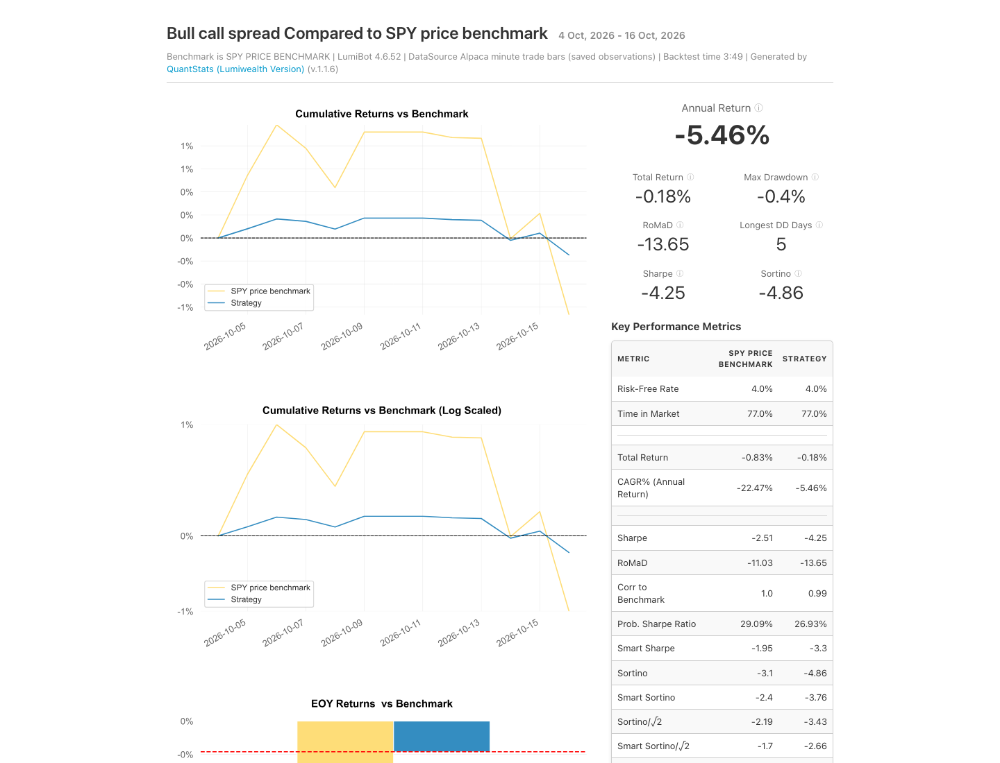

# Three AI options examples: audited local backtests

These are **local LumiBot runs**, not hosted BotSpot runs or live broker fills.
They used released LumiBot **4.6.52**, source
[`089159f12e04`](https://github.com/Lumiwealth/lumibot/tree/v4.6.52),
from October 5 through October 16, 2026: ten market sessions. All three lost
money. This short study demonstrates execution mechanics and reconciled
accounting; it does not establish a profitable trading edge.

## Source and mandates

| Example | Policy | Executed source |
| --- | --- | --- |
| Overnight iron condor | Consider one short credit condor near the close; next-session expiration, approximately 0.14 short delta, $1 wings, at most 3% account loss including estimated fees. The AI manages boundaries and the expiration-session exit. | [91 lines](https://github.com/Lumiwealth/lumibot/blob/v4.6.52/lumibot/example_strategies/ai_iron_condor.py) |
| Bull call spread | Regular bullish SPY exposure through an equal-quantity debit spread; weekly entry opportunities, 30–60-day expiration, 2% maximum-loss budget, review before the final 14 days. | [83 lines](https://github.com/Lumiwealth/lumibot/blob/v4.6.52/lumibot/example_strategies/ai_bull_call_spread.py) |
| 2:1 call stock replacement | Regular bullish SPY exposure through exactly two lower-strike long calls per higher-strike short call; monthly opportunities, 90–180-day expiration, 5% maximum-loss budget, review before the final 30 days. | [85 lines](https://github.com/Lumiwealth/lumibot/blob/v4.6.52/lumibot/example_strategies/ai_call_stock_replacement.py) |

Each example has one researcher and one trader. The AI trader chooses contracts,
quantities, prices and orders. Python observes the AI's saved attention
conditions and dispatches decision cycles. Quiet observations make no model
calls. Common quote, Greek, atomic-package, quantity, recovery and obligation
mechanics belong to LumiBot. These examples explicitly request AI ownership;
calculable strategies can instead use ordinary Python.

Expiration horizon, intended holding period, entry opportunity and review
frequency are separate policy choices. A weekly entry opportunity does not
mean selling and buying an otherwise healthy spread every week. The 2:1 package
is paid leveraged exposure, not free stock or a zero-cost promise.

## Historical results

| Example | Starting equity | Ending equity | Net change | Return | Assumed contract fees | Packages opened / closed | End exposure |
| --- | ---: | ---: | ---: | ---: | ---: | ---: | --- |
| Iron condor | $100,000.00 | $99,985.60 | −$14.40 | −0.0144% | $36.40 | 7 / 7 | Flat |
| Bull call spread | $100,000.00 | $99,815.70 | −$184.30 | −0.1843% | $1.30 | 1 / 0 | Open |
| 2:1 call stock replacement | $200,000.00 | $199,532.05 | −$467.95 | −0.2340% | $1.95 | 1 / 0 | Open |

LumiBot's native reports, generated from these saved runs with QuantStats Lumi
1.1.6: [iron condor](../../docsrc/_extra/tearsheets/ai-options-20261112/condor.html),
[bull call spread](../../docsrc/_extra/tearsheets/ai-options-20261112/vertical.html),
and [2:1 call stock replacement](../../docsrc/_extra/tearsheets/ai-options-20261112/replacement.html).
These GitHub links identify the downloadable HTML files; the documentation site
serves them as reports after its normal publication.

The native reports include the SPY price benchmark from the study's existing
minute observations. They use LumiBot's normal initial-capital anchor, shown as
October 4; the actual trading sessions remain October 5–16. No dividends were
supplied. Annualized statistics from ten sessions are descriptive extrapolations,
not an expected annual return. QuantStats Lumi currently uses a desktop-width
layout; narrow screens need horizontal scrolling. The reports were formatted without rerunning
strategy decisions, model calls or market-data requests. Original accounting
and trades are unchanged. Normal LumiBot backtests already enable interactive
trade charts and tear sheets; the original private launcher explicitly disabled
them. See [automatic reports and headless usage](../../docsrc/backtesting.how_to_backtest.rst).

The condor completed seven entries and seven closes, including re-entry after
closure. The vertical ended long one November 20 SPY $770 call and short one
$790 call. The replacement ended long two March 19, 2027 SPY $740 calls and
short one $765 call. The latter two results include marked open positions;
they are not realized closing profits or proof of a completed exit lifecycle.

Independent audits reconciled the contract identities, quantities, package
cash flows, fees, ending cash/equity and remaining positions with no accounting
issues. All final inference ledgers have zero unsettled requests. Full private
decision and order evidence is retained; it is not a public customer trace.

## Data and execution limits

- The simulations use **Alpaca minute trade bars**, not tick replay. A bar's
  traded price approximates execution. The study did not obtain historical
  option bid/ask quotes or prove simultaneous executable package size.
- Fees assume **$0.65 per contract per side**. This is a study assumption, not a
  claim about any connected broker's actual fee schedule.
- Live option decisions require actual quotes and assessment of the bid/ask
  spread. Historical bar simulation is separate from live quote or fill proof.
- Early exercise, assignment, residual shares, changing liquidity and model
  errors can affect actual outcomes. A submitted close is not a confirmed flat
  account.
- Ten sessions are insufficient to estimate long-term returns, regime
  resilience or reliable monthly inference usage. No result was selected as a
  profitable headline.

## Measured inference and latency

The runs used Luna High, Standard/default, through an owned Login with ChatGPT
pool. The executed model was explicitly configured as `chatgpt/gpt-6-luna`;
the examples' `model=None` alone does not select subscription funding.

| Example | Agent runs in the completed study | Fresh model requests in the final run | Final-run wall time |
| --- | ---: | ---: | ---: |
| Iron condor | 27: 10 researcher, 17 trader | 219 | 37.86 minutes |
| Bull call spread | 3: 1 researcher, 2 trader | 21 | 3.82 minutes |
| 2:1 call stock replacement | 23: 7 researcher, 16 trader | 203 | 33.69 minutes |

The condor first completed a separate two-session pilot with 46 fresh requests
and 8.73 minutes of runtime. The longer run reused compatible saved answers;
its 219 figure is fresh extension work, not the pilot plus the extension.
Agent runs and raw requests differ because tools require continuations.
Do not add overlapping usage snapshots together.

The replacement repeatedly attempted unfilled DAY entries before its eventual
fill. Its 203 fresh requests are a material inference and latency limitation;
it should not be described as uniformly cheap. Paid AI API use for these
subscription-only local runs was **$0**. This is not an account-wide billing
claim. The provider did not
expose the actual ChatGPT credit debit. Subscription usage is not unlimited or
free inference, and a catalogue API equivalent is not an actual charge.

## BotSpot availability

Matching revisions are saved on BotSpot. This study does **not** establish a
running BotSpot bot or a Marketplace listing. As last checked November 11,
2026, hosted Login with ChatGPT funding was awaiting provider approval and
issued connection details. Local login availability does not establish hosted
availability. No paid API fallback or live-money order was used for this work.

LumiBot 4.6.52 was published and independently installed. Bot Manager's
qualified fresh no-order bot reported the installed version as 4.6.52. That
runtime check is separate from execution of these three examples. Marketplace
links will be added only when actual listings exist; the Marketplace does not
require a hosted historical backtest.

Build/edit journeys are a later qualification: the real BotSpot Agent must
build or edit from a plain request, execute its own saved result, and pass
grading. Runtime trials of these example files do not count as those journeys.
