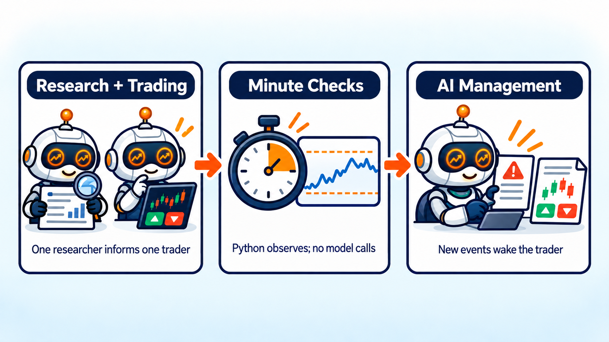

AI Iron Condor Trading Bot
==========================

.. meta::
   :description: An AI-owned SPY iron condor with a researcher, a dedicated trader and inexpensive minute observations. Review the source, requirements and validation limits.

This example considers a short iron condor on SPY near the market close. A researcher assesses the opportunity; a dedicated trader chooses the contracts, quantity and prices, places orders and manages risk. Protective options bound the expiration payoff, while quiet minute observations use no model. The trader may decline an unsuitable setup.

How it works
------------

1. During the final 15 regular-session minutes, the research agent reviews dated volatility, trend and event evidence. The policy excludes entry when the previous completed VIX close exceeds 25 or required evidence is unavailable.
2. The trader evaluates listed next-trading-day options near 0.14 absolute short delta with one-dollar protective wings. It chooses an integer package count within a 3% account-value maximum-loss budget and submits the related legs together with a net limit.
3. Python observes the trader's saved conditions each minute. Related new warnings start one decision cycle; quiet observations do not call either model. The trader is instructed to review closing when SPY crosses 40% of the distance from the short-strike midpoint toward either short strike.
4. The trader manages the held package and closes residual legs no later than 30 minutes before the expiration session ends. It reconciles working orders, partial fills and assignment obligations before a later entry. Python does not decide or submit those actions.

Run it on BotSpot
-----------------

`BotSpot <https://botspot.trade/marketplace?utm_source=documentation&utm_medium=docs&utm_campaign=lumibot_ai_examples&utm_content=agents_example_iron_condor_ai_trading_bot>`_ provides strategy creation, backtesting and broker connections. Before using this candidate source there, confirm that its attention API is available in the hosted runtime and that your connected account can supply the requested options history. This source rewrite has not yet completed historical qualification; no new Marketplace availability or performance result is claimed here.

The code
--------

The prompts contain the strategy decisions. The shared attention component observes conditions and coordinates agents; it does not choose quantities, prices or orders.

.. literalinclude:: ../lumibot/example_strategies/ai_iron_condor.py
   :language: python

Run it yourself
---------------

Use an installed LumiBot version containing the attention API before running this source. Configure the intended model funding and Alpaca data connection. For local Login with ChatGPT, follow :doc:`agents_chatgpt` and set the strategy's ``model`` parameter to ``chatgpt/gpt-6-luna``; hosted managed funding uses its normal model route and a separate connected account.

.. code-block:: bash

   python -m lumibot.example_strategies.ai_iron_condor

Set ``IS_BACKTESTING=true``, ``BACKTESTING_START`` and ``BACKTESTING_END`` for a backtest. Otherwise the module uses its configured broker. A paper Alpaca account alone does not establish all data permissions. Historical option trade bars are an approximation for fills, not proof of historical executable bid/ask prices.

Good to know
------------

* A research-and-trading decision can contain several model requests and tool continuations. Measure actual requests, tokens and latency; do not assume one call per day or a fixed backtest cost.
* The policy instructions and native lifecycle checks do not establish historical profitability. Updated historical backtest results remain pending.
* Expiration, early exercise, assignment, fees and execution costs can affect actual losses. The trader must reconcile resulting positions and obligations; a submitted close is not a confirmed flat account.

See :doc:`agents_examples` for more AI trading bots and :doc:`strategy_run_modes` for backtest and live runners.
