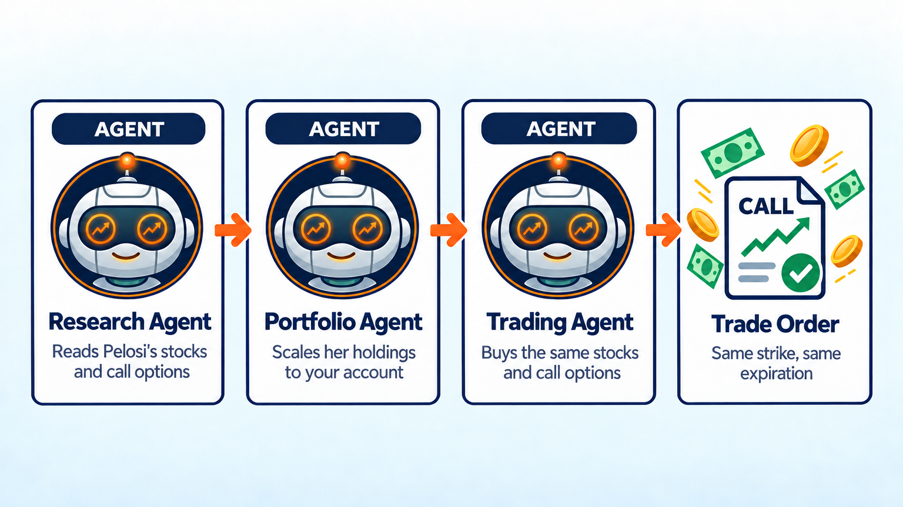

Nancy Pelosi Copy Trading Bot
=============================

.. meta::
   :description: This AI bot copies Nancy Pelosi's whole portfolio, call options included: her stocks plus calls on the same stocks with the same expiration, sized to your account. Free Python code for LumiBot.

Most Pelosi copy bots only buy her stocks. But much of her trading is call options: in her January 23, 2026 report alone she bought call options on Alphabet, Amazon, Apple and Nvidia that expire in January 2027 (`House Clerk report <https://disclosures-clerk.house.gov/public_disc/ptr-pdfs/2026/20033725.pdf>`__). This bot copies those too: it holds her stocks, plus calls on the same stocks with the same expiration dates, sized to your account.

Only want her stocks? Use the :doc:`agents_example_nancy_pelosi_trading_bot`.

How it works
------------

The bot has just two AI agents, and both run every day:

1. **Research agent** reads Pelosi's official financial disclosure reports on the House Clerk website (disclosures-clerk.house.gov): her newest yearly report plus every trade report filed since. It works out every stock and every call option she owns today, with the number of contracts, strike price and expiration date. It skips options that have already expired.
2. **Trading agent** sizes everything to your account and trades it. By default 20% goes to her calls and the rest to her stocks, in her proportions. Her calls cost $9,000 to $18,000 a contract, more than a normal account can spread around, so it uses her exact strike when one contract fits and otherwise the nearest strike that fits, with the same expiration date. It leaves a holding alone when it is within 2 percentage points of its target.

Want a different member of Congress? Change the name in the research agent's prompt.

Run it on BotSpot
-----------------

Run this bot on `BotSpot <https://botspot.trade/marketplace?utm_source=documentation&utm_medium=docs&utm_campaign=lumibot_ai_examples&utm_content=agents_example_nancy_pelosi_copy_trading_bot>`_ without installing anything. BotSpot runs LumiBot in the cloud, backtests it, and connects it to your broker.

The code
--------

The whole bot is one short file. The two prompts are the strategy. The research agent uses LumiBot's built-in web tools, which read ZIP files, PDFs, spreadsheets and web pages from any website.

.. literalinclude:: ../lumibot/example_strategies/ai_nancy_pelosi_copy_trading_bot.py
   :language: python

Run it yourself
---------------

.. code-block:: bash

   pip install lumibot
   python -m lumibot.example_strategies.ai_nancy_pelosi_copy_trading_bot

Put these in your ``.env`` file: ``OPENAI_API_KEY``, and your broker keys (for example ``ALPACA_API_KEY``, ``ALPACA_API_SECRET``, and ``ALPACA_IS_PAPER=true`` for paper trading). Your broker account needs options trading turned on. With ``IS_BACKTESTING=false`` the bot trades. With ``IS_BACKTESTING=true`` it backtests on Alpaca's price history instead, which has options from February 2024; set ``BACKTESTING_START`` and ``BACKTESTING_END`` to pick the dates, and start with a week or two, because every AI call costs a little.

Good to know
------------

* Change ``options_share`` to put more or less of your account into calls. Set it to ``0`` to copy only her stocks.
* A cheaper strike is a bigger bet on the stock going up than her strike: it is cheaper because it pays off only above a higher price.
* Call options can lose all their value by the expiration date.
* Members of Congress can take up to 45 days to report a trade, so the bot always buys late, often at a different price than she paid.
* Reports show dollar ranges, such as $1,000,001 to $5,000,000. The bot uses the middle of each range.
* The yearly report comes out in May and shows what she owned on December 31. Until the new one is filed, the bot starts from the year before and adds every trade since.
* In a backtest the website also shows reports from after the test date. The research agent reads the date on each report and skips any report filed after the test day.
* Pelosi said on November 6, 2025 that she will not run for re-election in 2026 (`NBC News <https://www.nbcnews.com/politics/congress/nancy-pelosi-first-female-speaker-house-wont-seek-re-election-congress-rcna239324>`__). Her reports stop after she leaves office, so change the name in the research prompt to keep the bot trading.
* The House website says its reports may not be used for most commercial purposes (5 U.S.C. 13107). Check that your use is allowed.

See :doc:`agents_examples` for more AI trading bots and :doc:`strategy_run_modes` for backtest and live runs.
