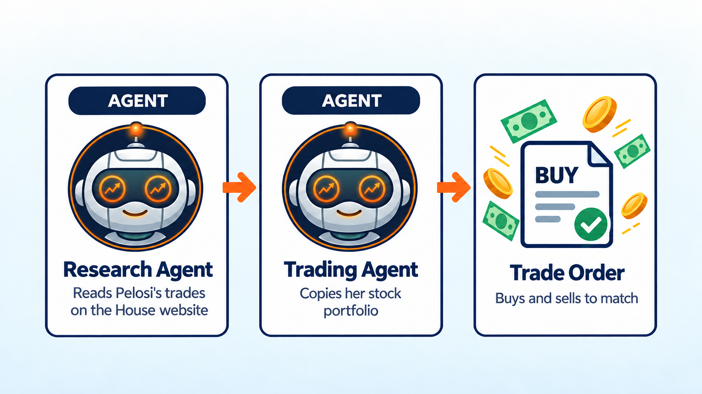

Nancy Pelosi Stock Trading Bot
==============================

.. meta::
   :description: Estimate Nancy Pelosi's disclosed household stock portfolio with research and trading agents. Free Python code to backtest with LumiBot.

This bot estimates Nancy Pelosi's publicly disclosed household stock and listed-partnership portfolio, then scales that basket to your account. It reads official House reports to reconstruct the full inventory. Delayed disclosures and value ranges make this an approximation of her holdings.

Want her call options too? The :doc:`agents_example_nancy_pelosi_copy_trading_bot` copies those as well.

How it works
------------

The bot has just two AI agents, and both run every day:

1. **Research agent** reads the newest eligible annual snapshot and subsequent transactions on the `House Clerk website <https://disclosures-clerk.house.gov/>`__. It returns every included issuer's numeric asset-value range, snapshot date, eligible share changes and sources. Transactions after the snapshot date apply once, even if filed before the annual report. Full sales remove a holding; partial sales reduce it.
2. **Trading agent** estimates shares from each range midpoint and its snapshot-date price, applies later share changes and values the remaining inventory at current prices. It allocates 99% of account capital across the complete feasible basket. Current quotes size trades; small constituents remain part of replication. New disclosures trigger a full rebalance, including exits and additions. On quiet days established positions within 2 percentage points of target stay in place.

There is no other code. Want a different member of Congress? Change the name in the research agent's prompt.

Run it on BotSpot
-----------------

Run this bot on `BotSpot <https://botspot.trade/marketplace?utm_source=documentation&utm_medium=docs&utm_campaign=lumibot_ai_examples&utm_content=agents_example_nancy_pelosi_trading_bot>`_ without installing anything. BotSpot runs LumiBot in the cloud, backtests it, and connects it to your broker.

The code
--------

The whole bot is one short file. The two prompts are the strategy. The research agent uses LumiBot's built-in web tools, which read ZIP files, PDFs, spreadsheets and web pages from any website.

.. literalinclude:: ../lumibot/example_strategies/ai_nancy_pelosi_trading_bot.py
   :language: python

Run it yourself
---------------

.. code-block:: bash

   pip install lumibot
   python -m lumibot.example_strategies.ai_nancy_pelosi_trading_bot

The example selects Luna High with API funding. Configure ``OPENAI_API_KEY`` and your broker keys (for example ``ALPACA_API_KEY``, ``ALPACA_API_SECRET`` and ``ALPACA_IS_PAPER=true``). For subscription funding, follow :doc:`agents_chatgpt` and select ``chatgpt/gpt-6-luna`` for both agents. With ``IS_BACKTESTING=false`` the bot trades. With ``IS_BACKTESTING=true`` it backtests; set ``BACKTESTING_START`` and ``BACKTESTING_END`` to choose the period. LumiBot's default starting account is $100,000. Both agents run every iteration, so a longer test makes more model calls.

Good to know
------------

* Members of Congress can take up to 45 days to report a trade, so the bot always sees trades late.
* Reports show dollar ranges, such as $1,000,001 to $5,000,000. Midpoints, snapshot prices and later disclosed changes produce estimated weights, not verified account balances.
* The yearly report comes out in May and shows what she owned on December 31. Until the new one is filed, the bot starts from the year before and adds every trade since.
* In a backtest the website also shows reports from after the test date. The research agent reads the date on each report and skips any report filed after the test day.
* Whole-share rounding can leave cash or slightly overrepresent a small constituent. A missing price is a specific exception; the supported remainder still gets allocated. A source lookup failure does not mean an existing holding was sold.
* Pelosi said on November 6, 2025 that she will not run for re-election in 2026 (`NBC News <https://www.nbcnews.com/politics/congress/nancy-pelosi-first-female-speaker-house-wont-seek-re-election-congress-rcna239324>`__). Her reports stop after she leaves office, so change the name in the research prompt to keep the bot trading.
* The House website says its reports may not be used for most commercial purposes (5 U.S.C. 13107). Check that your use is allowed.

See :doc:`agents_examples` for more AI trading bots and :doc:`strategy_run_modes` for backtest and live runs.
