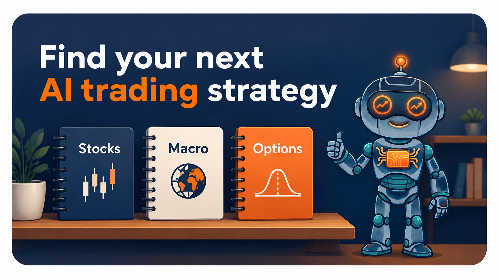

AI Trading Bot Examples
=======================

.. meta::
   :description: Free AI trading bot examples in Python: copy Nancy Pelosi's trades, follow insider buying, trade 0DTE options, and more. Each bot is two AI agents.

Pick a bot, read how it works, and run it. Each bot is a few sentences of plain
English. The agents fit the strategy: one agent for simple rules, a researcher
and a trader for most bots, and a debate or a team where that is the point.
Example pages show source and the available validation evidence. A candidate
without completed qualification is labeled explicitly.

.. include:: _snippets/botspot_mcp_callout.rst

Every file ends the same way: with ``IS_BACKTESTING=true`` in your ``.env`` file
it backtests, otherwise it trades with your broker. See :doc:`strategy_run_modes`.

Copy famous investors and insiders
----------------------------------

* :doc:`agents_example_nancy_pelosi_trading_bot`: owns the same stocks as Nancy Pelosi, rebuilt from her reports on the House website.
* :doc:`agents_example_nancy_pelosi_copy_trading_bot`: copies her whole portfolio, call options included, sized to your account.
* :doc:`agents_example_insider_trading_bot`: buys more of the stocks that CEOs and directors are buying with their own money.
* :doc:`agents_example_warren_buffett_ai_stock_picker`: owns great companies at fair prices, the way Warren Buffett describes it.
* :doc:`agents_example_bill_ackman_portfolio_ai_trading_bot`: holds a few high-conviction stocks, the way Bill Ackman invests.

Read the web with a real browser
--------------------------------

* :doc:`agents_example_fear_and_greed_index_trading_bot`: opens CNN's Fear & Greed Index in a browser and buys SPY on fear, sells on greed.

AI agents that debate
---------------------

* :doc:`agents_example_bull_vs_bear_ai_stock_trading_bot`: a bull agent and a bear agent argue about the biggest US stocks before the trade.
* :doc:`agents_example_tqqq_strategy_ai_trading_bot`: the same debate for leveraged ETFs like TQQQ and SQQQ.

Options
-------

* :doc:`agents_example_iron_condor_ai_trading_bot`: sells a one-day SPY iron condor at 3:45 PM and closes early if SPY runs toward a strike.
* :doc:`agents_example_put_credit_spread_ai_trading_bot`: sells a SPY put credit spread about a month out and manages the exit.
* :doc:`agents_example_0dte_options_ai_trading_bot`: sells a same-day SPY call spread and watches it every 15 minutes.

AI wheel candidate
~~~~~~~~~~~~~~~~~~

:download:`AI wheel source <../lumibot/example_strategies/ai_wheel.py>` starts
with SPY. Change the ``symbol`` parameter for another supported optionable ETF.
One researcher supplies compact dated evidence; the sole trader chooses contracts,
size, prices and risk actions. Cash-secured puts may deliver shares on assignment;
covered calls may call those shares away, returning the strategy to cash.

The example prefers 30–45 days to expiry, approximately 0.25 absolute delta,
one short contract, collateral within 90% of equity and 90% premium capture.
It accepts assignment and uses bounded limit orders. These are configurable
policy choices. Premium does not remove underlying downside or guarantee profit.

Startup planning runs once at the session start; the trader schedules entries
15 minutes before the actual session close by default. A planned entry can reuse
still-current planning research. Shared attention polls quietly through the closing
observation. When option capacity is free, cash can secure a put or shares
can cover a call, with a daily entry opportunity. An occupied option or working
order uses meaningful management events and a review within seven calendar days,
without daily setup research. Management can reuse dated research. One decision can still involve many model
and tool calls: measure actual usage rather than assuming one request per day.

**Qualification is incomplete.** This source needs the shared
``self.agents.attention`` API in the actual installed SDK. The November 1 Manager
smoke used LumiBot 4.6.37 but that installation lacked the API and failed before
trading. A matching version label alone does not establish capability. The local
candidate has completed short diagnostics, but actual-executor holding checks
passed only four of five trials: one incorrect profit threshold caused unnecessary
research. The latest historical candidate placed no trades. The current schedule
wording permits disclosed approximations, but has not had new model qualification.
Longer AI comparisons, full AI lifecycle and Marketplace installation remain pending.
The inspected Alpaca backtesting path also skips automatic option expiry delivery;
the native Pandas settlement checks do not qualify that path.
No Marketplace availability
or trading readiness is claimed.

Once the runtime is qualified and installed, configure an options-history source
and follow :doc:`agents_chatgpt` for local Login with ChatGPT. This example selects
``chatgpt/gpt-6-luna`` with Medium reasoning and Standard/default service. Optional
web research requires ``ddgs``. Model login and market-data permissions are separate.
For a portable project, save the source as ``main.py`` and the
:download:`wheel policy ledger <../lumibot/example_strategies/fixtures/ai_wheel_rules.json>`
as ``rules.json`` in the same directory. Both agents load that canonical ledger.
Set ``IS_BACKTESTING=true`` and your historical dates before executing:

.. code-block:: bash

   python main.py

Without backtest mode, the module invokes its configured broker runner; that path
has not been qualified for this example. Historical trade-bar limits do not prove
historical executable bid/ask spreads. Smart limits are deliberately not the default
while missing-quote fallback and repricing behavior remain under qualification.
See :doc:`strategy_run_modes` for runner and account selection.

Day trading
-----------

* :doc:`agents_example_vwap_strategy_ai_trading_bot`: buys SPY when it bounces back above VWAP.
* :doc:`agents_example_opening_range_breakout_ai_trading_bot`: buys the stock that breaks out above its first 15 minutes.

Hedge fund style AI teams
-------------------------

* :doc:`agents_example_citadel_sector_pods`: five sector agents pitch ideas to a risk manager and a portfolio manager.
* :doc:`agents_example_ray_dalio_idea_meritocracy`: growth, inflation, and debt agents argue before a trader builds a macro ETF basket.

A backtest shows the code works for that data and those dates. It is not a
promise of future returns. These examples are inspired by public ideas and are
not affiliated with or endorsed by the people or firms they are named after.

.. toctree::
   :hidden:

   agents_example_nancy_pelosi_trading_bot
   agents_example_nancy_pelosi_copy_trading_bot
   agents_example_insider_trading_bot
   agents_example_warren_buffett_ai_stock_picker
   agents_example_bill_ackman_portfolio_ai_trading_bot
   agents_example_fear_and_greed_index_trading_bot
   agents_example_bull_vs_bear_ai_stock_trading_bot
   agents_example_tqqq_strategy_ai_trading_bot
   agents_example_iron_condor_ai_trading_bot
   agents_example_put_credit_spread_ai_trading_bot
   agents_example_0dte_options_ai_trading_bot
   agents_example_vwap_strategy_ai_trading_bot
   agents_example_opening_range_breakout_ai_trading_bot
   agents_example_citadel_sector_pods
   agents_example_ray_dalio_idea_meritocracy

Build your own AI trading bot
-----------------------------

Want help turning your idea into a strategy? Learn with Rob in the free challenge.

