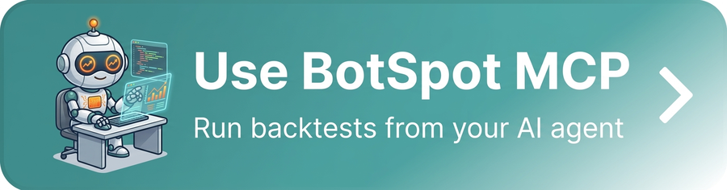

BotSpot MCP Integration
=======================

.. meta::
   :description: Connect your AI assistant to BotSpot to create LumiBot strategies, run historical backtests, inspect charts, and report on your account.

Use BotSpot MCP when you want your AI assistant to create and edit LumiBot
strategies, run hosted historical backtests, inspect results, and report on
your existing bots. Connecting is free. Paid BotSpot plans exist only for some
heavier features, and usage limits depend on your plan.

.. _why-botspot-mcp:

Why connect the free BotSpot MCP
--------------------------------

We strongly recommend it if you build with an AI assistant. One free connection
gives Claude, ChatGPT, Codex or Cursor what it needs to work on real trading
strategies instead of only writing code:

* **Strategy-building skills.** Your assistant learns how LumiBot strategies are
  built, so it writes code that runs.
* **Free data.** News, economic data and SEC filings, ready for research.
* **Backtests and charts.** Your assistant can run a historical backtest on
  BotSpot's servers and read the charts, trades and logs.
* **Cheap scheduled deployments.** Run a bot on BotSpot's servers on a schedule.
  For a bot that runs once a day, that is usually cheaper than keeping your own
  computer or server on all the time.
* **The community.** Read and post, and see what other people's bots and trades
  are doing.
* **The marketplace.** Research strategies other people published, and publish
  your own so others can use it.
* **Easy broker linking.** Connect a broker on the website instead of managing
  keys on a server.
* **More tools for LumiBot's own AI agents.** With ``lumibot connect botspot``,
  agents inside your strategies get BotSpot research tools (macro data, SEC
  research, marketplace and community reads).

Backtests are simulations. They do not promise future results.

`Connect it free at botspot.trade/agents <https://botspot.trade/agents?utm_source=documentation&utm_medium=mcp_page&utm_campaign=lumibot&utm_content=why_section>`__

Start with the `maintained setup guide <https://github.com/Lumiwealth/botspot-mcp#connect>`_.
It contains current Claude Code, Cursor, Codex and hosted-client instructions,
first-use prompts, pricing and connection troubleshooting.

Connect and try one workflow
----------------------------------------

1. Add the Streamable HTTP endpoint ``https://mcp.botspot.trade/mcp`` in your client.
2. Complete the client's normal BotSpot OAuth sign-in.
3. Ask the assistant to check account access, create a strategy, run a historical
   backtest, and inspect that exact run using the `starter prompts
   <https://github.com/Lumiwealth/botspot-mcp#your-first-useful-result>`_.

Strategy creation uses ``create_strategy`` followed by the saved-file and
revision tools. Every edit creates a new revision; start a backtest from the
newest saved revision. Keep the returned backtest ID for status, chart and
artifact requests. A queued backtest is not a completed result.

No brokerage connection is needed for the starter historical example when
your plan includes its required data. Backtests are simulations and do not
guarantee future returns.

Permissions and availability
----------------------------------------

The direct MCP connection includes trading and deployment actions, subject
to account permissions, plan entitlements and normal product approvals.
An account connection alone does not authorize a trade. Protect API keys;
never paste them into a chat or commit them to source control.

Custom MCP installation and public app-store approval are separate. The
planned restricted store connection is still awaiting qualification and
release. Check the `distribution tracker
<https://github.com/Lumiwealth/botspot-mcp/blob/main/docs/distribution-status.md>`_
for submitted, approved and installation-tested destinations.

To disconnect, use your client's connector controls. Revoke any separate
BotSpot API key through BotSpot Account Settings.

LumiBot strategy agents
----------------------

Create a named key in BotSpot's API Keys settings. Enable the independent public
research, Marketplace and Community-read permissions you need. Leave trading,
deployment, backtest-control, secret-management and Community-publication
permissions off unless you separately intend those capabilities. Expiry defaults
to Never; choose an expiry if needed. Store your key in your environment or
secret manager:

.. code-block:: bash

   export BOTSPOT_RESEARCH_MCP_URL="https://api.botspot.trade/research-mcp"
   export BOTSPOT_RESEARCH_MCP_TOKEN="botspot_YOUR_RESEARCH_KEY"

Or let the command line check the key and write both values to ``.env``:

.. code-block:: bash

   lumibot connect botspot

LumiBot attaches that connection when you create a strategy agent. Static keys
do not need a renewal URL. BotSpot-hosted runtimes supply their own short-lived
capability and renewal endpoint; never copy those runtime tokens elsewhere.
Endpoints require HTTPS outside loopback, and renewal must use the same origin.
Never put credentials in a URL, query string or fragment.

The connection discovers datasets through ``search_data_catalog`` and reads
structured observations with ``query_data`` or documents with
``search_documents`` and ``get_document``. It also reads permitted Marketplace
listings, code and accounts, and the Community feed. Protected code and private
positions retain the owner's sharing and purchase rules.

In a backtest, LumiBot limits research requests to the strategy's actual UTC
clock. Hosted server authorization must also verify that simulation clock; an
authenticated backtest workload alone does not establish the current timestamp.
Without a trusted server clock binding, time-dependent reads return
``unsupported_capability`` before fetching data. Never bypass this by requesting
live data or substituting an external key.
Sources without original-version and publication-time proof return a visible
``unsupported_capability`` error. Calendar dates or today's revised economic
tables do not establish what was available historically. Record missing
evidence and the provider used; changing a news source requires a new backtest.

Edit the same independent switches to narrow a key or revoke it on the existing
API Keys page. Hosted bot settings are separate from key creation; disabling
hosted research or revoking a selected key denies that hosted access too.
Community publication requires separate explicit account, key and bot consent.
BotSpot owns supplier credentials, normalization, storage and source qualification;
LumiBot is the client. Research access never grants deployment, backtest-control,
trading or secret-management authority.

Frequently asked questions
--------------------------

What is BotSpot MCP?
~~~~~~~~~~~~~~~~~~~~

BotSpot MCP connects your AI assistant to BotSpot. Your assistant can then
create and edit LumiBot strategies, run hosted historical backtests, look at
the results and report on your existing bots.

How is BotSpot related to LumiBot?
~~~~~~~~~~~~~~~~~~~~~~~~~~~~~~~~~~

LumiBot is the open source Python trading framework. BotSpot is the hosted
service around it. It runs hosted backtests and handles broker connections,
results and scheduling for LumiBot strategies. See
`BotSpot for AI agents <https://botspot.trade/agents>`_.

Is BotSpot MCP free?
~~~~~~~~~~~~~~~~~~~~

Yes, connecting is free. Paid BotSpot plans exist only for some heavier
features, and usage limits depend on your plan. The
`setup guide <https://github.com/Lumiwealth/botspot-mcp#connect>`_ has current
pricing.

What is the BotSpot MCP server URL?
~~~~~~~~~~~~~~~~~~~~~~~~~~~~~~~~~~~

Add the Streamable HTTP endpoint ``https://mcp.botspot.trade/mcp`` in your
client, then finish the normal BotSpot sign in. The
`BotSpot agents page <https://botspot.trade/agents>`_ lists the exact steps for
each client.

Which AI assistants work with BotSpot MCP?
~~~~~~~~~~~~~~~~~~~~~~~~~~~~~~~~~~~~~~~~~~

The `BotSpot agents page <https://botspot.trade/agents>`_ lists ChatGPT,
Claude, Claude Code, Codex, Gemini CLI and Cursor. Some sign in with OAuth and
some use a BotSpot API key.

Do I need a brokerage account to run a backtest?
~~~~~~~~~~~~~~~~~~~~~~~~~~~~~~~~~~~~~~~~~~~~~~~~

No. The starter historical example needs no brokerage connection when your
plan includes the data it uses. Backtests are simulations and do not promise
future returns.

Can my AI assistant place trades through BotSpot MCP?
~~~~~~~~~~~~~~~~~~~~~~~~~~~~~~~~~~~~~~~~~~~~~~~~~~~~~

The direct MCP connection includes trading and deployment actions. They still
depend on your account permissions, your plan and the normal product
approvals. Connecting an account alone does not approve a trade.

What should I try first?
~~~~~~~~~~~~~~~~~~~~~~~~

Ask your assistant to check your account access, create a strategy, run a
historical backtest and then inspect that exact run. The
`starter prompts <https://github.com/Lumiwealth/botspot-mcp#your-first-useful-result>`_
show how. Keep the backtest ID it returns, and remember that a queued backtest
is not a finished result.

How do I disconnect BotSpot MCP?
~~~~~~~~~~~~~~~~~~~~~~~~~~~~~~~~

Use your AI client's connector controls. If you also made a BotSpot API key,
revoke it in BotSpot Account Settings.
