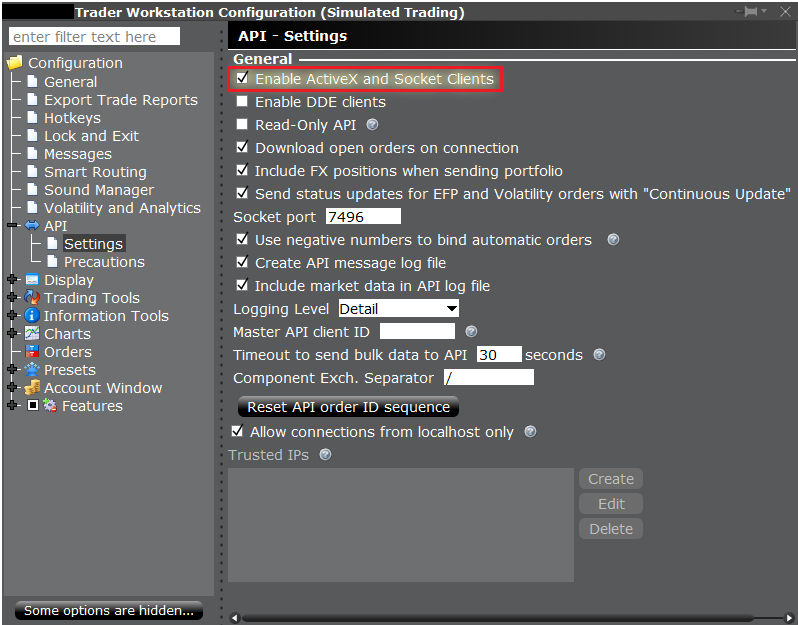

Interactive Brokers Legacy
===================================

.. meta::
   :description: This method has been deprecated. Please use the other Interactive Brokers tutorial. LumiBot documentation.

.. include:: _snippets/botspot_mcp_callout.rst

.. note::
    This method has been deprecated. Please use the other Interactive Brokers tutorial.

Once installed, navigate in Trader Workstation to ``File -> Global Configuration -> API -> Settings`` The key settings required to trade using Lumibot are:

#. Enable ActiveX and Socket Clients
#. Disable Read-Only API
#. Socket port ``7496`` for live trading, ``7497`` for paper account trading.
    * NOTE: It is highly recommended to thoroughly test your algorithm in paper trading mode before trading live.
#. Master API Client ID: You can find in the Trader Workstation by going to ``File -> Global Configurations -> API -> Settings``, then looking for "Master API client ID". This can be any number you choose up to ``999``. You will use this in your configuration file to log in.

Set up your credentials as follows in ``credentials.py``:

.. code-block:: python

    INTERACTIVE_BROKERS_CONFIG = {
        "SOCKET_PORT": 7497,
        "CLIENT_ID": "your Master API Client ID three digit number",
        "IP": "127.0.0.1",
    }

Set up your entry point file as above, except using Interactive Brokers. Here is an example of a completed file:

.. code-block:: python
    :emphasize-lines: 3,12

    from lumibot.traders import Trader
    # Import interactive brokers
    from lumibot.brokers import InteractiveBrokers
    from lumibot.strategies.examples import Strangle
    from credentials import INTERACTIVE_BROKERS_CONFIG

    trader = Trader()
    # Initialize interactive brokers
    interactive_brokers = InteractiveBrokers(INTERACTIVE_BROKERS_CONFIG)

    strategy = Strangle(broker=interactive_brokers)
    trader.add_strategy(strategy)
    trader.run_all()

You can also see the file simple_start_ib.py for a working bot here: https://github.com/Lumiwealth/lumibot/blob/master/getting_started/simple_start_ib.py

Frequently asked questions
--------------------------

Is the Trader Workstation (TWS) method still supported?
~~~~~~~~~~~~~~~~~~~~~~~~~~~~~~~~~~~~~~~~~~~~~~~~~~~~~~~

It still exists in LumiBot as the ``InteractiveBrokers`` broker, but it is deprecated. For new projects, use the Client Portal setup in :doc:`brokers.interactive_brokers`.

Which TWS port should I use for paper and live trading?
~~~~~~~~~~~~~~~~~~~~~~~~~~~~~~~~~~~~~~~~~~~~~~~~~~~~~~~

Use socket port ``7497`` for a paper account and ``7496`` for live trading. The port in LumiBot must match the port set in TWS.

Which TWS API settings does LumiBot need?
~~~~~~~~~~~~~~~~~~~~~~~~~~~~~~~~~~~~~~~~~

In TWS, open File, Global Configuration, API, Settings. Turn on "Enable ActiveX and Socket Clients" and turn off "Read-Only API".

What is the Master API client ID?
~~~~~~~~~~~~~~~~~~~~~~~~~~~~~~~~~

It is a number you choose in the same TWS API settings screen, up to ``999``. Put the same number in your LumiBot config as ``CLIENT_ID``.

Can I set the TWS connection with environment variables?
~~~~~~~~~~~~~~~~~~~~~~~~~~~~~~~~~~~~~~~~~~~~~~~~~~~~~~~~

Yes. LumiBot reads ``INTERACTIVE_BROKERS_PORT``, ``INTERACTIVE_BROKERS_CLIENT_ID`` and ``INTERACTIVE_BROKERS_IP``. The IP defaults to ``127.0.0.1``. ``IB_SUBACCOUNT`` is optional.

If keys for other brokers are also set, add ``TRADING_BROKER=ib`` to force this connection.

Does TWS have to be running while my bot trades?
~~~~~~~~~~~~~~~~~~~~~~~~~~~~~~~~~~~~~~~~~~~~~~~~

Yes. This method connects to the API socket that TWS opens on your computer. TWS must be open and logged in for your strategy to get prices and place orders.
