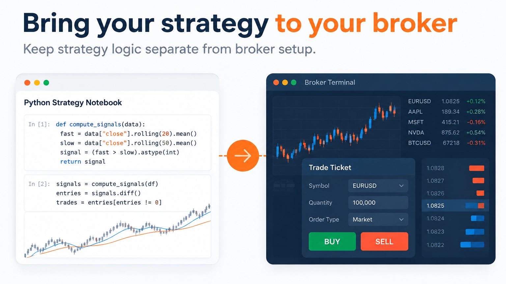
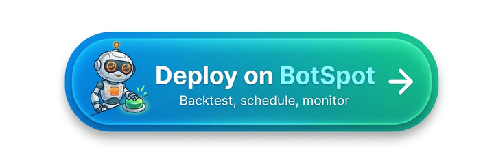
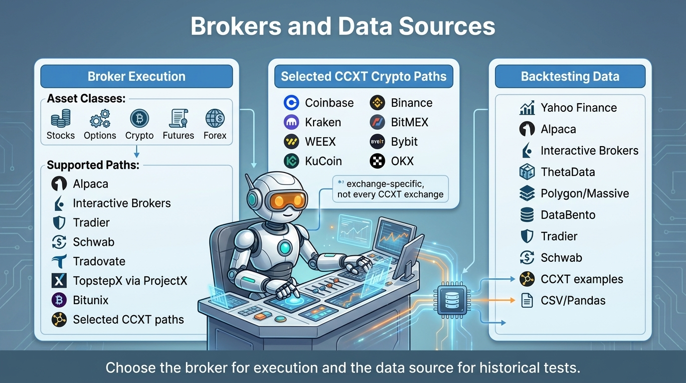

Trading Brokers Supported by LumiBot
====================================

.. meta::
   :description: Compare trading brokers supported by LumiBot for stocks, options, crypto, futures, forex, paper trading, live trading, and backtesting.

LumiBot connects to **100+ brokers and crypto exchanges**. There are nine direct broker integrations (Alpaca, Charles Schwab, Interactive Brokers, Tradier, Tradovate, TopstepX through ProjectX, Bitunix, Kalshi and Polymarket) plus one shared crypto broker built on the `CCXT library <https://github.com/ccxt/ccxt>`__, which accepts the 100+ exchange ids your installed CCXT version lists. The same strategy code backtests, paper trades and trades live. Browse by group below, or open the :doc:`A to Z list of every broker and exchange <brokers.all>`.

An optional :doc:`MetaMask Agent Wallet beta <brokers.metamask>` adds dedicated agent wallets, exact-input swaps, and Hyperliquid perpetuals; connected testnet qualification is required.

.. include:: _snippets/botspot_mcp_callout.rst

.. list-table:: Common LumiBot broker paths
   :header-rows: 1
   :widths: 22 27 20 31

   * - Broker path
     - Main asset classes
     - Authentication
     - Setup
   * - Alpaca
     - Stocks, ETFs, options, crypto
     - API keys or OAuth
     - :doc:`Alpaca guide <brokers.alpaca>`
   * - Charles Schwab
     - Equities, ETFs, single-leg options
     - OAuth application
     - :doc:`Schwab guide <brokers.schwab>`
   * - Interactive Brokers REST
     - Multi-asset markets supported by the account
     - Client Portal session
     - :doc:`IBKR REST guide <brokers.interactive_brokers>`
   * - Interactive Brokers legacy
     - Multi-asset markets supported by TWS
     - TWS or IB Gateway
     - :doc:`Legacy IBKR guide <brokers.interactive_brokers_legacy>`
   * - CCXT exchanges
     - Crypto spot, margin, or derivatives by exchange
     - Exchange API keys
     - :doc:`CCXT comparison <brokers.ccxt>`
   * - Bitunix
     - USDT perpetual futures
     - API key and secret
     - :doc:`Bitunix guide <brokers.bitunix>`
   * - Tradier
     - Stocks and options
     - Access token and account number
     - :doc:`Tradier guide <brokers.tradier>`

Brokers by asset class
----------------------

Many brokers trade more than one asset class. In the menu each broker appears under every asset class it supports. Alpaca, for example, is listed under Stocks, Options and Crypto. Use this table to find brokers for stocks, options, futures, crypto, forex or prediction markets.

.. list-table:: Asset classes each broker supports in LumiBot
   :header-rows: 1
   :widths: 28 10 10 10 10 10 12

   * - Broker
     - Stocks
     - Options
     - Futures
     - Crypto
     - Forex
     - Prediction markets
   * - :doc:`Alpaca <brokers.alpaca>`
     - Yes
     - Yes
     -
     - Yes
     -
     -
   * - :doc:`Charles Schwab <brokers.schwab>`
     - Yes
     - Yes
     -
     -
     -
     -
   * - :doc:`Interactive Brokers <brokers.interactive_brokers>`
     - Yes
     - Yes
     - Yes
     -
     - Yes
     -
   * - :doc:`Interactive Brokers (legacy TWS) <brokers.interactive_brokers_legacy>`
     - Yes
     - Yes
     - Yes
     -
     - Yes
     -
   * - :doc:`Tradier <brokers.tradier>`
     - Yes
     - Yes
     -
     -
     -
     -
   * - :doc:`Tradovate <brokers.tradovate>`
     -
     -
     - Yes
     -
     -
     -
   * - :doc:`TopstepX (ProjectX) <brokers.projectx>`
     -
     -
     - Yes
     -
     -
     -
   * - :doc:`Bitunix <brokers.bitunix>`
     -
     -
     - Crypto perpetuals
     - Yes
     -
     -
   * - :doc:`100+ crypto exchanges <brokers.crypto>`
     -
     -
     - Crypto perpetuals and futures, where the exchange offers them
     - Yes
     -
     -
   * - Kalshi (see :doc:`brokers.prediction_markets`)
     -
     -
     -
     -
     -
     - Yes
   * - :doc:`Polymarket <brokers.polymarket>`
     -
     -
     -
     -
     -
     - Yes

Broker setup is easier on `BotSpot <https://botspot.trade/sales?showLogin=1&utm_source=documentation&utm_medium=brokers&utm_campaign=lumibot&utm_content=broker_setup_text&sample=lumibot_deploy_sample>`_ because the broker connection, strategy runtime, account checks, monitoring, alerts, audit history, and kill-switch controls live in one platform.

- **Connect brokers through the website.** Avoid rebuilding secret storage, environment variables, broker account checks, and deployment configuration for every server.
- **Start from backtested code.** Move the same Lumibot strategy from hosted backtesting to paper or live trading without rebuilding the infrastructure around it.
- **Monitor what the bot is doing.** Review logs, trades, account state, alerts, and decisions in one place so you can understand why a strategy acted.
- **Use AI and MCP with broker context.** BotSpot can work from the web app, your phone, Telegram, Discord, Claude, ChatGPT, Codex, Cursor, and other MCP clients while keeping the broker and strategy context together.

.. toctree::
   :maxdepth: 2
   :hidden:

   Stocks <brokers.stocks_options>
   Options <brokers.options>
   Futures <brokers.futures>
   Crypto <brokers.crypto>
   Forex <brokers.forex>
   Prediction markets <brokers.prediction_markets>
   Backtesting data sources <brokers.data_sources>
   All brokers A to Z <brokers.all>

Brokers by type
---------------

* **Stocks:** :doc:`Alpaca <brokers.alpaca>`, :doc:`Charles Schwab <brokers.schwab>`, :doc:`Interactive Brokers <brokers.interactive_brokers>` and :doc:`Tradier <brokers.tradier>`. See :doc:`brokers.stocks_options`.
* **Options:** the same four. See :doc:`brokers.options`.
* **Forex:** :doc:`Interactive Brokers <brokers.interactive_brokers>`. See :doc:`brokers.forex`.
* **Futures:** :doc:`Tradovate <brokers.tradovate>`, :doc:`TopstepX through ProjectX <brokers.projectx>`, :doc:`Interactive Brokers <brokers.interactive_brokers>`, plus crypto perpetuals on :doc:`Bitunix <brokers.bitunix>` and many crypto exchanges. See :doc:`brokers.futures`.
* **Crypto:** 100+ exchanges (Binance, Coinbase, Kraken, OKX, Bybit, Hyperliquid and more), :doc:`Bitunix <brokers.bitunix>` and :doc:`Alpaca <brokers.alpaca>`. See :doc:`brokers.crypto`.
* **Prediction markets:** Kalshi and :doc:`Polymarket <brokers.polymarket>`. See :doc:`brokers.prediction_markets`.
* **Backtesting data sources:** you do not need a broker to backtest. See :doc:`brokers.data_sources` for Yahoo, Polygon, ThetaData, Databento, Interactive Brokers, Alpaca and your own CSV data.
* **Every broker and exchange:** :doc:`brokers.all` lists all of them in one table you can filter.

Frequently asked questions
--------------------------

How many brokers does LumiBot support?
~~~~~~~~~~~~~~~~~~~~~~~~~~~~~~~~~~~~~~

LumiBot has ten broker integrations (Alpaca, Charles Schwab, Interactive Brokers, Tradier, Tradovate, TopstepX through ProjectX, Bitunix, Kalshi, Polymarket and the CCXT crypto broker). The CCXT broker accepts any exchange id from your installed CCXT version, which lists more than 100 crypto exchanges. The :doc:`A to Z list <brokers.all>` links every guide.

Which broker should I start with?
~~~~~~~~~~~~~~~~~~~~~~~~~~~~~~~~~

For US stocks, ETFs and options, Alpaca is the quickest start because it offers free paper trading accounts with API keys. For futures, use Tradovate, TopstepX or Interactive Brokers. For crypto, use the CCXT page for your exchange.

Do I need a broker to backtest?
~~~~~~~~~~~~~~~~~~~~~~~~~~~~~~~

No. Backtests run on historical data. Yahoo Finance daily data needs no account and no API key. See :doc:`backtesting`.

Can I paper trade before using real money?
~~~~~~~~~~~~~~~~~~~~~~~~~~~~~~~~~~~~~~~~~~

Yes, on brokers that offer it. Alpaca, Tradier, Interactive Brokers and Tradovate have paper or demo accounts, and many crypto exchanges have a testnet that the CCXT broker can use with ``"sandbox": True``. Each broker guide says whether paper trading is available.

Can an AI agent trade through any of these brokers?
~~~~~~~~~~~~~~~~~~~~~~~~~~~~~~~~~~~~~~~~~~~~~~~~~~~

Yes. LumiBot AI agents submit orders through the same order pipeline as Python strategies, so any broker on this page works with an agent. See :doc:`agents`.

Can I switch brokers without rewriting my strategy?
~~~~~~~~~~~~~~~~~~~~~~~~~~~~~~~~~~~~~~~~~~~~~~~~~~~

Yes. Strategy code does not change. You change the broker credentials in your ``.env`` file, or set ``TRADING_BROKER``. Asset types still have to be ones the new broker can trade.

Is LumiBot free?
~~~~~~~~~~~~~~~~

Yes. LumiBot is open source under the GPL-3.0 license. You pay your broker's own commissions and fees, any market data subscriptions, and your AI model provider if you use agents.
