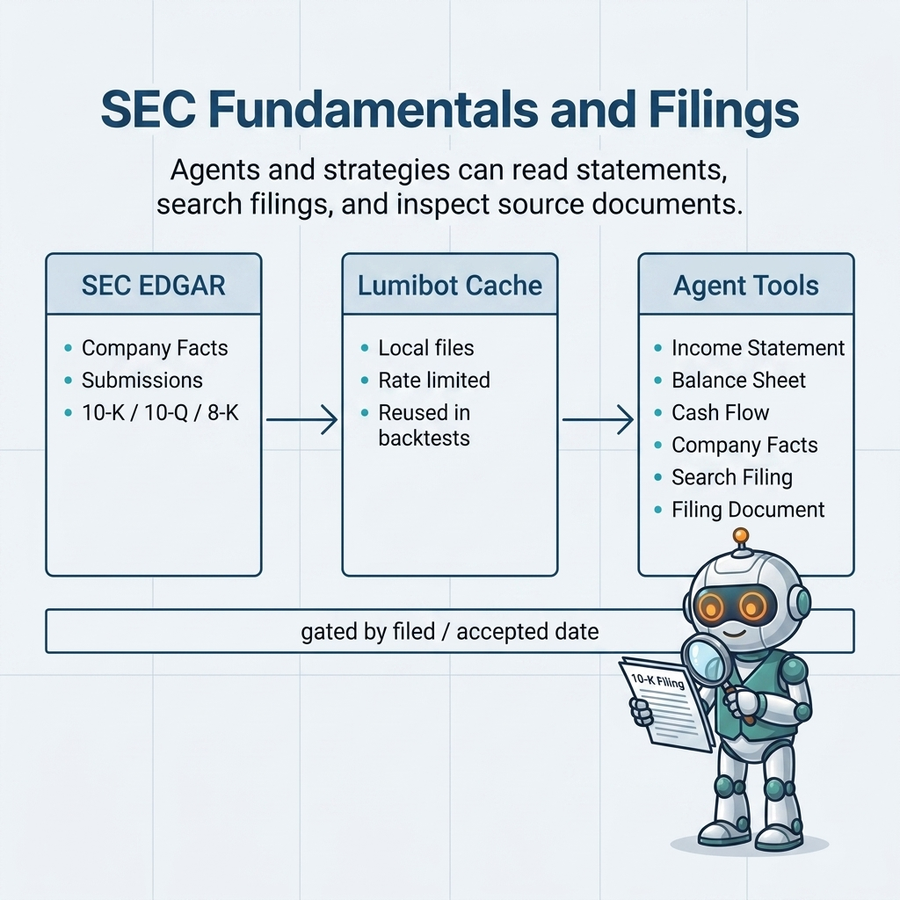
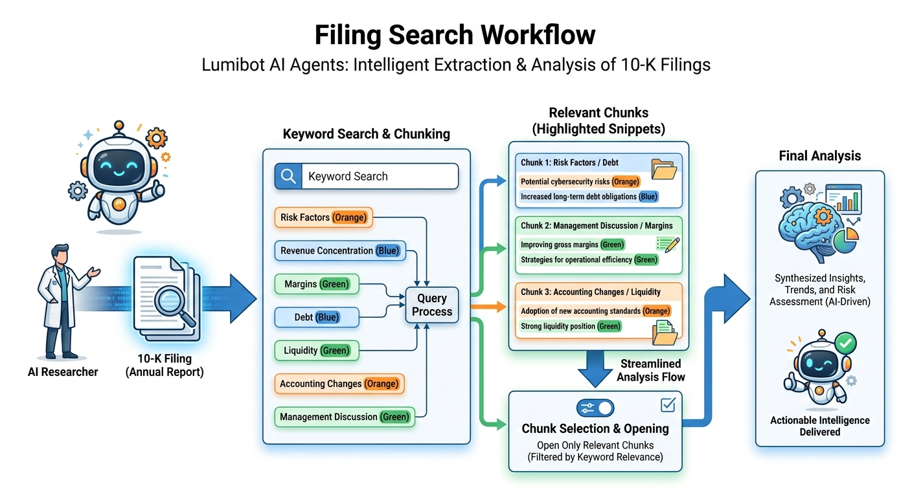

Fundamental Data (SEC Filings) for Backtests and Live Strategies
================================================================

.. meta::
   :description: Free point-in-time fundamental data for Python trading strategies: income statements, balance sheets, cash flow and filings from SEC EDGAR, with no look-ahead in backtests.
   :keywords: fundamental data, SEC EDGAR, 10-K, 10-Q, income statement, balance sheet, cash flow, point in time, backtest, stock scanner, Python

LumiBot gives every strategy free fundamental data for US-listed companies,
straight from SEC EDGAR: income statements, balance sheets, cash flow, any
reported XBRL fact, and the filings themselves. No API key, no paid data feed.

It works the same in backtests and live trading, and in backtests it is
**point in time**: a strategy only sees numbers that were public at the
simulated moment. A plain Python strategy calls ``self.fundamentals`` directly;
AI agents get the same data as built-in tools.

.. include:: _snippets/botspot_mcp_callout.rst

Quick start: a fundamentals scanner
-----------------------------------

This strategy ranks a universe by revenue growth each month, skips companies
with heavy debt or a high P/E, and buys the top five. Every number is what was
public at the backtest date. Copy it, change the universe, and backtest it.

.. code-block:: python

   from datetime import datetime

   from lumibot.backtesting import YahooDataBacktesting
   from lumibot.strategies import Strategy

   UNIVERSE = ["AAPL", "MSFT", "AMZN", "GOOGL", "META", "NVDA", "JPM", "JNJ", "PG", "COST"]

   class RevenueGrowthScanner(Strategy):
       def initialize(self):
           self.sleeptime = "1D"
           self.vars.month = None

       def on_trading_iteration(self):
           now = self.get_datetime()
           if self.vars.month == now.month:
               return  # rebalance once a month
           self.vars.month = now.month

           # One table for the whole universe: one row per symbol, as of today's bar.
           table = self.fundamentals.get_metrics_table(
               UNIVERSE, ["revenue_growth_yoy", "debt_to_equity", "pe_ratio"]
           )
           table = table.dropna(subset=["revenue_growth_yoy"])  # missing data is skipped, never filled in
           table = table[(table["debt_to_equity"].fillna(0) < 2) & (table["pe_ratio"].fillna(0) < 60)]
           picks = list(table.sort_values("revenue_growth_yoy", ascending=False).index[:5])

           for position in self.get_positions():
               if position.asset.symbol not in picks and position.asset != self.quote_asset:
                   self.submit_order(self.create_order(position.asset, position.quantity, "sell"))
           budget = self.get_portfolio_value() / max(len(picks), 1)
           for symbol in picks:
               price = self.get_last_price(symbol)
               held = self.get_position(symbol)
               quantity = int(budget // price) - (int(held.quantity) if held else 0)
               if quantity > 0:
                   self.submit_order(self.create_order(symbol, quantity, "buy"))

   if __name__ == "__main__":
       RevenueGrowthScanner.backtest(YahooDataBacktesting, datetime(2024, 1, 1), datetime(2024, 12, 31))

Ready-made metrics
------------------

Ask for a metric in one line. Each is computed from filings public at the
backtest date (or ``as_of``), and is ``None`` when it cannot be computed:

.. code-block:: python

   self.fundamentals.get_metric("AAPL", "pe_ratio")            # one number or None
   self.fundamentals.get_metrics("AAPL")                       # all of them, with reasons
   self.fundamentals.get_metrics_table(["AAPL", "MSFT"])       # pandas table for a scanner

.. list-table::
   :header-rows: 1

   * - Metric
     - What it is
   * - ``ttm_revenue``, ``ttm_net_income``, ``ttm_eps_diluted``
     - Trailing twelve months: latest annual report plus the latest
       year-to-date quarter, minus the same quarter a year earlier
   * - ``revenue_growth_yoy``
     - TTM revenue versus TTM revenue one year earlier
   * - ``gross_margin``, ``net_margin``
     - TTM gross profit (or revenue minus cost of revenue) and TTM net income,
       over TTM revenue for the same twelve months
   * - ``ttm_free_cash_flow``
     - TTM operating cash flow minus TTM capital expenditures
   * - ``debt_to_equity``
     - Long-term debt (including the current portion when reported) over
       stockholders' equity, from the same balance sheet
   * - ``current_ratio``
     - Current assets over current liabilities, same balance sheet
   * - ``shares_outstanding``
     - Cover-page shares outstanding from the latest filing
   * - ``book_value_per_share``
     - Stockholders' equity over shares outstanding
   * - ``market_cap``, ``pe_ratio``, ``ps_ratio``, ``pb_ratio``
     - Price times shares outstanding, and price over TTM EPS, TTM revenue per
       share and book value per share

Price-based metrics use ``price=`` when you pass it (``prices={...}`` for the
table), otherwise the strategy's last price at the current bar. ``price=`` is
the price as traded on that date. A backtest price that is adjusted for a later
stock split is converted back to the price traded that day.

**Stock splits.** A filing reports EPS and share counts on the share basis of
the day it was filed. After a 10-for-1 split, a filing made before the split
shows EPS ten times higher than the shares now trading. LumiBot converts diluted
EPS, shares outstanding and book value per share to the share basis on the date
you ask about, so P/E, P/S, P/B and market cap stay right across a split (NVIDIA
on 2024-06-12, two days after its 10-for-1 split: P/E about 73, market cap about
$3.1 trillion). Split dates come from the backtest's price data, from SEC
filings that restate earlier periods on the new basis, and outside a backtest
from Yahoo Finance's split history (``SECFundamentals(split_history=...)``
replaces it). When a split cannot be dated reliably, the value is ``None`` and
the reason names the split. You never get a number on the wrong share basis.

When a metric is ``None``, ``get_metrics(...)["reasons"]`` says why, for
example ``"no long-term debt filed for the balance sheet dated 2024-03-31
(missing debt is not treated as zero)"`` or ``"TTM diluted EPS is not positive,
so P/E is not meaningful"``. Nothing is estimated or filled in: a missing input,
a period the company did not report, or a latest filing more than 18 months old
gives ``None``, not an old or made-up number. ``get_metrics(...)["periods"]``
names the period, filing and availability time behind every value.

Methods
-------

.. code-block:: python

   self.fundamentals.preload(["AAPL", "MSFT", ...])        # warm a universe in one call
   self.fundamentals.get_metrics_table(["AAPL", "MSFT"])   # ratios for a universe (see above)
   self.fundamentals.get_income_statement("AAPL")          # latest statement as of now
   self.fundamentals.get_balance_sheet("AAPL")
   self.fundamentals.get_cash_flow("AAPL")
   self.fundamentals.get_fact_history("AAPL", "Revenues")  # every period, as known now
   self.fundamentals.get_company_facts("AAPL")
   self.fundamentals.get_filings("AAPL", form="10-K")
   self.fundamentals.search_filing("AAPL", accession_number="...", query="risk")
   self.fundamentals.get_filing_document("AAPL", accession_number="...")

Every method takes an optional ``as_of``. In a backtest it defaults to the
strategy's current time, and an ``as_of`` later than that is capped to it.

- **Statements** (``get_income_statement``, ``get_balance_sheet``,
  ``get_cash_flow``) return the newest reporting period that was public, with
  each value's tag, unit, period, form, accession number, ``filed`` date and
  ``available_at`` (the moment LumiBot treats it as public). Fields are never
  mixed across periods: a field missing from the newest period is left out and
  listed in ``warnings``.
- **Fact history** (``get_fact_history``) returns every reported period of a
  us-gaap tag (annual, quarterly and year-to-date, exactly as filed), each with
  the value known at ``as_of``. Pass a list of tags in priority order when
  companies use different names for the same thing, such as revenue.
- **Company facts** (``get_company_facts``) returns the latest value of each
  fact, capped at important fields so agent runs stay small. Pass
  ``max_facts=None`` for all of them or ``raw=True`` for the SEC payload,
  filtered to ``as_of``.
- **Filings** (``get_filings``, ``search_filing``, ``get_filing_document``,
  ``list_filing_sections``, ``get_filing_section``) read the filing documents
  themselves. Prefer ``search_filing`` before opening a whole document.

Point in time: what a backtest can see
--------------------------------------

Three rules keep backtests honest:

1. **A value is usable once its filing is public.** The SEC acceptance time is
   used when it can change the answer. A filing accepted during or before a
   weekday session is usable from that moment; one accepted after the 4:00 PM
   New York close (or on a weekend) is usable from the next session's open.
   When no acceptance time is published, the value is usable from 9:30 AM New
   York on the day after its filing date. A filing made after the close is
   never visible at that morning's open.
2. **Restatements apply only from their own filing.** If a later 10-K revises
   last year's revenue, a backtest dated before that 10-K sees the number as
   first reported, and one dated after sees the revision.
3. **The newest period wins.** An amendment filed later for an older year
   never replaces the current statement.

Speed and caching
-----------------

Each company's facts are parsed once per process into an in-memory table keyed
by when each value became public, so a statement call after that is a fast
lookup. Measured on one machine: 180 statement calls (5 companies, 12 monthly
dates) took 0.24 seconds on a warm cache, against 25 seconds before this table
existed.

- ``preload(symbols)`` downloads a whole universe in parallel, spaced to stay
  under the SEC's limit of 10 requests per second. It returns which symbols
  loaded and which have no SEC data (ETFs, foreign listings, crypto), with a
  reason for each.
- Downloads are cached under ``~/.lumibot/cache/sec`` (override with
  ``LUMIBOT_SEC_CACHE_DIR``). When LumiBot's remote backtest cache is
  configured (see :doc:`environment_variables`), backtests also share the raw
  SEC files through it, so a second backtest machine downloads nothing the
  first one already fetched.
- In a backtest, a cached file fetched after the backtest's end date is used as
  is. An older copy may be missing filings inside the window, so it is
  refetched, at most once a day. Live strategies refresh after five minutes.
- LumiBot sends a contact-style user agent, as the SEC asks. Override it with
  ``LUMIBOT_SEC_USER_AGENT``.

Limits
------

- **US SEC filers only.** ETFs, most foreign companies (which file 20-F or
  40-F without full XBRL), crypto and private companies have no data here.
  ``get_filings`` reports that with ``available: false`` instead of raising.
- **Only what companies tag in XBRL.** Older filings (before about 2009 to 2011,
  depending on company size) have no machine-readable facts. Different
  companies use different tags for the same idea, especially revenue, so check
  more than one tag.
- **Dimensional values are not included.** The SEC company facts API only
  carries totals, not segment or share-class breakdowns.
- **Acceptance times** come from the SEC's recent-submissions list, which holds
  roughly the latest thousand filings per company. Older filings use the
  conservative day-after-filing rule.
- **No analyst estimates, no price data.** Combine with your strategy's own
  price data.
- **Splits right after a filing.** Between a split and the company's next
  filing, SEC data alone cannot say exactly when the split happened. LumiBot
  then needs a split history (the backtest's price data or Yahoo Finance); if
  none is available, per-share values and price ratios are ``None`` with the
  reason. A split between a filing's cover-page share date and its filing date
  (a few days) is not detected.
- **TTM needs a company that reports year-to-date quarters.** Most US filers
  do. Banks and insurers often have no gross profit, so ``gross_margin`` is
  ``None`` for them.
- **The ticker map is today's.** The SEC ticker list maps each current ticker
  to today's registrant. A company that changed its registrant (for example a
  new holding company) or a ticker reused by another company maps to the
  current one, and older history may be missing for it.

Agent tools
-----------

AI agents receive these built-ins: ``get_income_statement``,
``get_balance_sheet``, ``get_cash_flow``, ``get_company_facts``,
``get_filings``, ``search_filing``, ``get_filing_document``,
``list_filing_sections`` and ``get_filing_section``. They follow the same
point-in-time rules.

Related
-------

- :doc:`macro_data` for rates, inflation, unemployment and other economy-wide
  data from FRED.
- :doc:`standalone_components` to use ``SECFundamentals`` in scripts and
  notebooks without a strategy.
- Want to run a fundamentals scanner without setting anything up? The free
  `BotSpot MCP <https://botspot.trade/agents>`_ lets Claude, ChatGPT or Cursor
  build, backtest and host LumiBot strategies, and
  `botspot.trade <https://botspot.trade>`_ hosts them in the cloud.
