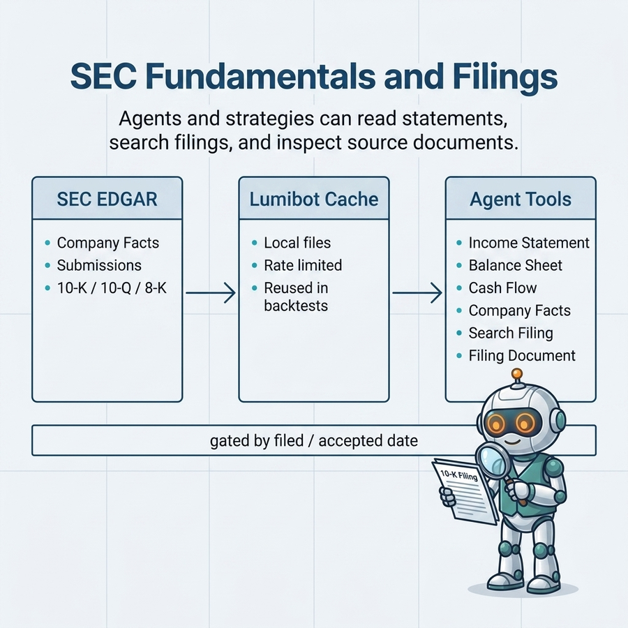
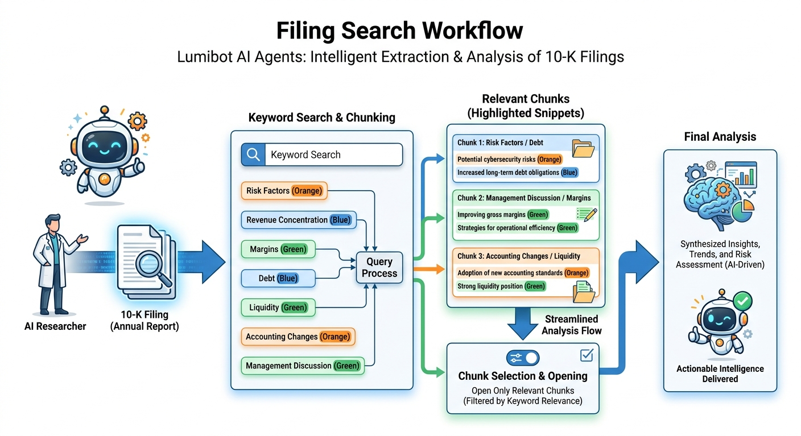

Fundamental Data (SEC Filings) for Backtests and Live Strategies
================================================================

.. meta::
   :description: Free point-in-time fundamental data for Python trading strategies: income statements, balance sheets, cash flow and filings from SEC EDGAR, with no look-ahead in backtests.
   :keywords: fundamental data, SEC EDGAR, 10-K, 10-Q, income statement, balance sheet, cash flow, point in time, backtest, stock scanner, Python

LumiBot gives every strategy free fundamental data for US-listed companies,
straight from SEC EDGAR: income statements, balance sheets, cash flow, any
reported XBRL fact, and the filings themselves. No API key, no paid data feed.

It works the same in backtests and live trading, and in backtests it is
**point in time**: a strategy only sees numbers that were public at the
simulated moment. A plain Python strategy calls ``self.fundamentals`` directly;
AI agents get the same data as built-in tools.

.. include:: _snippets/botspot_mcp_callout.rst

Quick start: a fundamentals scanner
-----------------------------------

This strategy ranks a universe by revenue growth each month, skips companies
with heavy debt or a high P/E, and buys the top five. Every number is what was
public at the backtest date. Copy it, change the universe, and backtest it.

.. code-block:: python

   from datetime import datetime

   from lumibot.backtesting import YahooDataBacktesting
   from lumibot.strategies import Strategy

   UNIVERSE = ["AAPL", "MSFT", "AMZN", "GOOGL", "META", "NVDA", "JPM", "JNJ", "PG", "COST"]

   class RevenueGrowthScanner(Strategy):
       def initialize(self):
           self.sleeptime = "1D"
           self.vars.month = None

       def on_trading_iteration(self):
           now = self.get_datetime()
           if self.vars.month == now.month:
               return  # rebalance once a month
           self.vars.month = now.month

           # One table for the whole universe: one row per symbol, as of today's bar.
           table = self.fundamentals.get_metrics_table(
               UNIVERSE, ["revenue_growth_yoy", "debt_to_equity", "pe_ratio"]
           )
           table = table.dropna(subset=["revenue_growth_yoy"])  # missing data is skipped, never filled in
           table = table[(table["debt_to_equity"].fillna(0) < 2) & (table["pe_ratio"].fillna(0) < 60)]
           picks = list(table.sort_values("revenue_growth_yoy", ascending=False).index[:5])

           for position in self.get_positions():
               if position.asset.symbol not in picks and position.asset != self.quote_asset:
                   self.submit_order(self.create_order(position.asset, position.quantity, "sell"))
           budget = self.get_portfolio_value() / max(len(picks), 1)
           for symbol in picks:
               price = self.get_last_price(symbol)
               held = self.get_position(symbol)
               quantity = int(budget // price) - (int(held.quantity) if held else 0)
               if quantity > 0:
                   self.submit_order(self.create_order(symbol, quantity, "buy"))

   if __name__ == "__main__":
       RevenueGrowthScanner.backtest(YahooDataBacktesting, datetime(2024, 1, 1), datetime(2024, 12, 31))

Ready-made metrics
------------------

Ask for a metric in one line. Each is computed from filings public at the
backtest date (or ``as_of``), and is ``None`` when it cannot be computed:

.. code-block:: python

   self.fundamentals.get_metric("AAPL", "pe_ratio")            # one number or None
   self.fundamentals.get_metrics("AAPL")                       # all of them, with reasons
   self.fundamentals.get_metrics_table(["AAPL", "MSFT"])       # pandas table for a scanner

.. list-table::
   :header-rows: 1

   * - Metric
     - What it is
   * - ``ttm_revenue``, ``ttm_net_income``, ``ttm_eps_diluted``
     - Trailing twelve months: latest annual report plus the latest
       year-to-date quarter, minus the same quarter a year earlier
   * - ``revenue_growth_yoy``
     - TTM revenue versus TTM revenue one year earlier
   * - ``gross_margin``, ``net_margin``
     - TTM gross profit (or revenue minus cost of revenue) and TTM net income,
       over TTM revenue for the same twelve months
   * - ``ttm_free_cash_flow``
     - TTM operating cash flow minus TTM capital expenditures
   * - ``debt_to_equity``
     - Long-term debt (including the current portion when reported, and
       finance lease obligations when the company files them together) over
       stockholders' equity, both from the latest balance sheet that has both
   * - ``current_ratio``
     - Current assets over current liabilities, same balance sheet
   * - ``shares_outstanding``
     - Cover-page shares outstanding from the latest filing. Companies with
       several share classes file no single total; for them it is the basic
       weighted average share count of the latest filed period
   * - ``book_value_per_share``
     - Stockholders' equity over shares outstanding
   * - ``market_cap``, ``pe_ratio``, ``ps_ratio``, ``pb_ratio``
     - Price times shares outstanding, and price over TTM EPS, TTM revenue per
       share and book value per share

Price-based metrics use ``price=`` when you pass it (``prices={...}`` for the
table), otherwise the strategy's last price at the current bar. ``price=`` is
the price as traded on that date.

**The market cap rule.** Market cap as of a date is the shares outstanding on
that date's share basis times the price a share actually traded at that day.
Backtest prices are often adjusted: lowered for every later stock split, and by
some data sources for every later dividend too, so a ten-year-old adjusted price
can be a small fraction of what a share cost then. LumiBot never multiplies an
adjusted price by a share count. It first turns the backtest price back into the
price traded that day:

- When the data source can also read unadjusted prices (Alpaca backtests), the
  ratio of the day's unadjusted close to its adjusted close undoes splits and
  dividends exactly. A jump in that ratio also dates each split to the day.
- Otherwise the splits listed in the price data after the date are undone.
- When neither is possible and a later split is known, the value is ``None``
  with the reason. An adjusted price is never used as if it had traded.

A data source of your own can support this by implementing
``get_backtest_as_traded_daily_closes(asset)``: return a daily DataFrame with
``close`` (the close your backtest prices use) and ``as_traded_close``.

**Stored daily tables make screens fast.** Ranking 500 companies by market
cap needs a price for every one of them on every rebalance date. When a stored
daily table is available in the backtest cache, ``get_metrics_table`` reads it
instead: one row per company per trading session, built with the same rules as
``get_metrics`` at that day's 4:00 PM New York close and that day's traded close.
Your strategy code does not change, and only the stocks you buy need price
history. A stored row is used only after its session closed (a strategy running
at the open sees the previous close) and never more than 7 days later. When a
table covers the date, a company it leaves out (no filing data or no reliable
close that day) has no value, so the screen never downloads its prices. When no
table covers the date, values are computed as described above. Build your own tables with
``lumibot.fundamentals.metrics_history.build_metrics_history(sec, closes)`` and
``save_metrics_history(sec, frame)``, where ``closes`` maps each symbol to a
Series of the closes actually traded each day. Set
``LUMIBOT_SEC_METRICS_HISTORY=0`` to ignore stored tables.

**Share counts filed at the wrong scale.** Companies sometimes file the
cover-page share count a thousand or a million times too large or too small.
LumiBot uses a filed count only when it is within 50 times of another count the
company filed (the usual value of the same line in its earlier filings, or the
weighted average shares of the latest period). A count that disagrees with all
of them is skipped and the latest earlier count that passes is used. When no
filed count can be confirmed, ``shares_outstanding`` and ``market_cap`` are
``None`` and the reason says so.

**Stock splits.** A filing reports EPS and share counts on the share basis of
the day it was filed. After a 10-for-1 split, a filing made before the split
shows EPS ten times higher than the shares now trading. LumiBot converts diluted
EPS, shares outstanding and book value per share to the share basis on the date
you ask about, so P/E, P/S, P/B and market cap stay right across a split (NVIDIA
on 2024-06-12, two days after its 10-for-1 split: P/E about 73, market cap about
$3.1 trillion). Split dates come from the backtest's price data, from SEC
filings that restate earlier periods on the new basis, and outside a backtest
from Yahoo Finance's split history (``SECFundamentals(split_history=...)``
replaces it). When a split cannot be dated reliably, the value is ``None`` and
the reason names the split. You never get a number on the wrong share basis.

When a metric is ``None``, ``get_metrics(...)["reasons"]`` says why, for
example ``"no long-term debt filed for the balance sheet dated 2024-03-31
(missing debt is not treated as zero)"`` or ``"TTM diluted EPS is not positive,
so P/E is not meaningful"``. Nothing is estimated or filled in: a missing input,
a period the company did not report, or a latest filing more than 18 months old
gives ``None``, not an old or made-up number. ``get_metrics(...)["periods"]``
names the period, filing and availability time behind every value.

Stock screener: market cap, revenue growth and debt for a whole universe
------------------------------------------------------------------------

``get_metrics_table`` returns one pandas row per symbol with the metrics you
ask for, as of the backtest date. Sort and filter it with plain pandas.

Top 5 companies by market cap, rebalanced monthly:

.. code-block:: python

   table = self.fundamentals.get_metrics_table(UNIVERSE, ["market_cap"])
   table = table.dropna(subset=["market_cap"]).drop_duplicates("cik")   # one row per company
   targets = list(table["market_cap"].astype(float).nlargest(5).index)  # for example ["AAPL", "MSFT", ...]

Revenue growth over 20% and debt to equity under 0.5, fastest growers first:

.. code-block:: python

   table = self.fundamentals.get_metrics_table(UNIVERSE, ["revenue_growth_yoy", "debt_to_equity"])
   table = table[["revenue_growth_yoy", "debt_to_equity"]].astype(float).dropna()
   picks = table[(table["revenue_growth_yoy"] > 0.20) & (table["debt_to_equity"] < 0.5)]
   targets = list(picks["revenue_growth_yoy"].nlargest(5).index)

- **Market cap on a past date** is shares outstanding from the latest filing
  that was public on that date, times the price that day. In a backtest the
  price is the strategy's own price at the current bar, so the only market data
  a screener needs is daily bars for its universe. ``prices={...}`` and
  ``as_of=`` let you ask about any date outside a strategy.
- **Market cap is for the whole company, all share classes.** The share count
  is, in this order: the single count on the filing's cover page or balance
  sheet; for a company that files one count per class, the basic weighted
  average share count of the latest period; and when it files neither (or its
  classes are not one for one), the per-class counts on the cover page of the
  latest annual or quarterly report, added up. Classes are added one for one
  unless LumiBot has a conversion on record (Berkshire Hathaway: one Class A
  share is 1,500 Class B shares). Visa's Class B and C shares convert into more
  than one Class A share, so Visa comes out about 10% low.
- **Two tickers of one company give the same market cap.** ``GOOGL`` and
  ``GOOG`` both return Alphabet's whole value. The table's ``cik`` column is
  the SEC company id: ``drop_duplicates("cik")`` keeps one row per company so a
  top-N list does not hold the same company twice.
- **Any value can be missing, and a missing value never passes a filter.** A
  metric that cannot be computed is ``None`` (the ``reasons`` column says why).
  ``dropna()`` leaves those companies out; filling with zero would make a
  company with no debt line look debt free. What to expect, measured on today's
  S&P 500 members as of June 2024: market cap for 494 of 503 and debt to
  equity for 402 of 503.

  - ``market_cap`` is missing when today's ticker points to a company that had
    not filed yet on that date (a spin-off or new listing), when a stock
    split cannot be dated, when the price traded that day cannot be recovered
    from an adjusted backtest price, or when no filed share count can be
    confirmed.
  - A share-class ticker can be written with a dot, dash, slash or space
    (``BRK.B``, ``BRK-B``, ``BRK/B``, ``BRK B``): all find the same company.
  - ``debt_to_equity`` is missing for most banks, insurers and asset managers
    (they do not file a long-term debt line), for companies with no long-term
    debt line at all, and when stockholders' equity is zero or negative (about
    30 large companies that bought back more stock than their book equity).
  - ``revenue_growth_yoy`` is missing until two years of revenue are public.
- **You choose the universe, as a list of tickers.** Passing an index name such as ``"S&P 500"`` raises a clear error. LumiBot does not ship index membership lists.
  If you pass today's members of an index to a backtest, the result has
  survivorship bias: companies that were dropped from the index (often after
  falling) are missing, and companies are included before they joined.

Two complete strategies are in ``lumibot/example_strategies``:
`stock_top_market_cap.py <https://github.com/Lumiwealth/lumibot/blob/dev/lumibot/example_strategies/stock_top_market_cap.py>`_
and
`stock_revenue_growth_low_debt.py <https://github.com/Lumiwealth/lumibot/blob/dev/lumibot/example_strategies/stock_revenue_growth_low_debt.py>`_.

New listings (IPOs): which companies went public, and when
----------------------------------------------------------

``self.fundamentals.get_listings(start, end)`` returns every company whose first
final prospectus (SEC form 424B4 or 424B1) is dated between two days, including
companies that were later delisted, bought out or went bankrupt. Today's ticker
list only holds survivors, so an IPO study built on it leaves out the losers;
this list keeps them, with the ticker printed on their own prospectus.

Columns: ``cik``, ``name``, ``ticker``, ``prospectus_date``, ``form``, ``kind``
(``operating_company``, ``blank_check`` for SPACs, or ``other`` for funds and
finance subsidiaries; only operating companies unless you pass for example
``kinds=("operating_company", "blank_check")``), ``sic``, ``delisting_filed``
(the delisting or deregistration filed after the company's last report, empty
until it is public; a move to another exchange does not count) and
``prospectus_url``.

.. code-block:: python

   from datetime import date, timedelta

   def on_trading_iteration(self):
       today = self.get_datetime().date()
       # Companies that went public in the last 30 days, as known today
       new = self.fundamentals.get_listings(today - timedelta(days=30), today)
       for ticker in new["ticker"].dropna():
           bars = self.get_historical_prices(ticker, 30, "day")
           ...

       # "Only trade companies public for at least 5 years"
       row = self.fundamentals.get_listing("RDDT")
       if row and (today - date.fromisoformat(row["prospectus_date"])).days >= 5 * 365:
           ...

Good to know:

- In a backtest a company appears only on or after its prospectus date, and a
  delisting only once it was filed: nothing from the future.
- The prospectus is filed 0 to 2 business days after the first trade. The first
  trade date is the stock's first daily bar from your price source.
- Companies already public before 2019 have no row unless the table was built
  for earlier years. ``get_listing`` returns ``None`` for them: treat it as "not
  a recent listing", not as missing data.
- Direct listings (no prospectus with an offering price) are not in the list.
- Price history for delisted companies depends on your data source. Some
  sources only keep live tickers, so a delisted company can have no bars at all;
  count and report those instead of dropping them silently.
- Options on a new stock usually start 3 to 5 business days after its first
  trade (exchange rule: three closes at $3 or more first). Shorting a new stock
  may not be possible early; a backtest cannot know borrow availability or fees.
- The table is built from public SEC files with
  ``self.fundamentals.build_listings_table(range(2019, 2027))`` (about 20
  minutes) and shared through the backtest cache, so most strategies only read it.

Methods
-------

.. code-block:: python

   self.fundamentals.get_listings("2024-01-01", "2024-12-31")  # companies that went public in 2024
   self.fundamentals.get_listing("RDDT")                   # one company's listing row, or None
   self.fundamentals.preload(["AAPL", "MSFT", ...])        # warm a universe in one call
   self.fundamentals.get_metrics_table(["AAPL", "MSFT"])   # ratios for a universe (see above)
   self.fundamentals.get_income_statement("AAPL")          # latest statement as of now
   self.fundamentals.get_balance_sheet("AAPL")
   self.fundamentals.get_cash_flow("AAPL")
   self.fundamentals.get_fact_history("AAPL", "Revenues")  # every period, as known now
   self.fundamentals.get_company_facts("AAPL")
   self.fundamentals.get_filings("AAPL", form="10-K")
   self.fundamentals.search_filing("AAPL", accession_number="...", query="risk")
   self.fundamentals.get_filing_document("AAPL", accession_number="...")

Every method takes an optional ``as_of``. In a backtest it defaults to the
strategy's current time, and an ``as_of`` later than that is capped to it.

- **Statements** (``get_income_statement``, ``get_balance_sheet``,
  ``get_cash_flow``) return the newest reporting period that was public, with
  each value's tag, unit, period, form, accession number, ``filed`` date and
  ``available_at`` (the moment LumiBot treats it as public). Fields are never
  mixed across periods: a field missing from the newest period is left out and
  listed in ``warnings``.
- **Fact history** (``get_fact_history``) returns every reported period of a
  us-gaap tag (annual, quarterly and year-to-date, exactly as filed), each with
  the value known at ``as_of``. Pass a list of tags in priority order when
  companies use different names for the same thing, such as revenue.
- **Company facts** (``get_company_facts``) returns the latest value of each
  fact, capped at important fields so agent runs stay small. Pass
  ``max_facts=None`` for all of them or ``raw=True`` for the SEC payload,
  filtered to ``as_of``.
- **Filings** (``get_filings``, ``search_filing``, ``get_filing_document``,
  ``list_filing_sections``, ``get_filing_section``) read the filing documents
  themselves. Prefer ``search_filing`` before opening a whole document.

Point in time: what a backtest can see
--------------------------------------

Three rules keep backtests honest:

1. **A value is usable once its filing is public.** The SEC acceptance time is
   used when it can change the answer. A filing accepted during or before a
   weekday session is usable from that moment; one accepted after the 4:00 PM
   New York close (or on a weekend) is usable from the next session's open.
   When no acceptance time is published, the value is usable from 9:30 AM New
   York on the day after its filing date. A filing made after the close is
   never visible at that morning's open.
2. **Restatements apply only from their own filing.** If a later 10-K revises
   last year's revenue, a backtest dated before that 10-K sees the number as
   first reported, and one dated after sees the revision.
3. **The newest period wins.** An amendment filed later for an older year
   never replaces the current statement.

Speed and caching
-----------------

Each company's facts are parsed once per process into an in-memory table keyed
by when each value became public, so a statement call after that is a fast
lookup. Measured on one machine: 180 statement calls (5 companies, 12 monthly
dates) took 0.24 seconds on a warm cache, against 25 seconds before this table
existed.

- ``preload(symbols)`` downloads a whole universe in parallel, spaced to stay
  under the SEC's limit of 10 requests per second. It returns which symbols
  loaded and which have no SEC data (ETFs, foreign listings, crypto), with a
  reason for each.
- Downloads are cached under ``~/.lumibot/cache/sec`` (override with
  ``LUMIBOT_SEC_CACHE_DIR``). When LumiBot's remote backtest cache is
  configured (see :doc:`environment_variables`), backtests also share the raw
  SEC files through it, so a second backtest machine downloads nothing the
  first one already fetched.
- In a backtest, a cached file fetched after the backtest's end date is used as
  is. An older copy may be missing filings inside the window, so it is
  refetched, at most once a day. Live strategies refresh after five minutes.
- LumiBot sends a contact-style user agent, as the SEC asks. Override it with
  ``LUMIBOT_SEC_USER_AGENT``.

Fast screens over many companies
--------------------------------

A screen such as "market cap for 500 stocks" does not need each company's full
SEC facts file (3 to 4 MB per company). The first time a company is loaded,
LumiBot saves a compact file beside it holding only the facts the statements
and metrics read (shares, revenue, income, cash flow, debt, equity and the
other statement lines, each with its filing date). Later runs read the compact
file first. It is stored in the same local cache, and in the remote backtest
cache when one is configured, under ``sec/companyfacts_compact/``. The values
are the same: the compact file is built from the full one and follows the same
freshness rules. A fact outside the compact set (``get_fact_history`` with any
other tag, ``get_company_facts(raw=True)``) opens the full file for that
company only.

Two more small files keep large SEC files out of a backtest's loop. Both hold
values read from SEC files, nothing estimated, and both are stored in the local
cache and in the remote backtest cache when one is configured:

- ``sec/submissions_acceptance/``: the exact acceptance time of each recent
  filing of a company (two columns of its submissions file, which is hundreds
  of kilobytes). It carries the submissions file's SEC fetch time and follows
  the same freshness rules. ``get_metrics_table`` loads the ones a date needs
  for the whole universe together.
- ``sec/cover_share_counts/``: for companies that file share counts per share
  class, the counts read from each filing's cover page. A filing never changes,
  so its XBRL data (megabytes) is read once, not once per backtest.

Measured on the 503 companies of a large-cap index, one ``market_cap`` table per
month on a warm local cache: 0.69 seconds per table before, 0.33 seconds after,
same values.

.. code-block:: python

   symbols = ["AAPL", "MSFT", "NVDA", ...]              # your universe
   self.fundamentals.preload(symbols)                   # compact files, in parallel
   table = self.fundamentals.get_metrics_table(symbols, metrics=["market_cap"])
   largest = table.dropna(subset=["market_cap"]).sort_values("market_cap", ascending=False).head(20)

Measured on one machine on 2026-11-14 for 503 large US companies, SEC data
only, one date (prices passed in):

.. list-table::
   :header-rows: 1

   * - Case
     - Seconds
     - SEC requests
     - Data read
   * - First run ever, nothing cached (full files from the SEC)
     - 58
     - 515
     - 1,655 MB
   * - Later run, full files on disk (before 4.6.65)
     - 14
     - 0
     - 1,655 MB
   * - Later run, compact files on disk
     - 5
     - 0
     - 16 MB
   * - New machine, compact files in the remote cache
     - 6 to 7
     - 0 to 5
     - 14 MB

After loading, a metrics table for all 503 companies takes under one second,
for any set of metrics. The first run ever still downloads the full files once
(the SEC publishes facts per company); building the compact files adds a few
seconds to that run.

Limits
------

- **US SEC filers only.** ETFs, most foreign companies (which file 20-F or
  40-F without full XBRL), crypto and private companies have no data here.
  ``get_filings`` reports that with ``available: false`` instead of raising.
- **Only what companies tag in XBRL.** Older filings (before about 2009 to 2011,
  depending on company size) have no machine-readable facts. Different
  companies use different tags for the same idea, especially revenue, so check
  more than one tag.
- **Dimensional values are not included.** The SEC company facts API only
  carries totals, not segment or share-class breakdowns.
- **Acceptance times** come from the SEC's recent-submissions list, which holds
  roughly the latest thousand filings per company. Older filings use the
  conservative day-after-filing rule.
- **No analyst estimates, no price data.** Combine with your strategy's own
  price data.
- **Splits right after a filing.** Between a split and the company's next
  filing, SEC data alone cannot say exactly when the split happened. LumiBot
  then needs a split history (the backtest's price data or Yahoo Finance); if
  none is available, per-share values and price ratios are ``None`` with the
  reason. A split between a filing's cover-page share date and its filing date
  (a few days) is not detected.
- **TTM needs a company that reports year-to-date quarters.** Most US filers
  do. Banks and insurers often have no gross profit, so ``gross_margin`` is
  ``None`` for them.
- **The ticker map is today's.** The SEC ticker list maps each current ticker
  to today's registrant. A company that changed its registrant (for example a
  new holding company) or a ticker reused by another company maps to the
  current one, and older history may be missing for it. When the current
  registrant had filed nothing yet on the date you ask about, every metric is
  ``None`` and the reason says so (and statements carry the same warning).
  SEC data does not link a new registrant to its predecessor. LumiBot keeps a
  short list of known predecessors (``lumibot/fundamentals/company_records.py``:
  Alphabet and Google, Broadcom and Avago, Exxon Mobil, BlackRock, Disney) and
  uses the earlier registrant's filings for dates before the change. For any
  other ticker it does not guess one; add a row there, with its source, when
  you need that history.

Agent tools
-----------

AI agents receive these built-ins: ``get_income_statement``,
``get_balance_sheet``, ``get_cash_flow``, ``get_company_facts``,
``get_filings``, ``search_filing``, ``get_filing_document``,
``list_filing_sections`` and ``get_filing_section``. They follow the same
point-in-time rules.

Related
-------

- :doc:`macro_data` for rates, inflation, unemployment and other economy-wide
  data from FRED.
- :doc:`standalone_components` to use ``SECFundamentals`` in scripts and
  notebooks without a strategy.
- Want to run a fundamentals scanner without setting anything up? The free
  `BotSpot MCP <https://botspot.trade/agents>`_ lets Claude, ChatGPT or Cursor
  build, backtest and host LumiBot strategies, and
  `botspot.trade <https://botspot.trade>`_ hosts them in the cloud.
