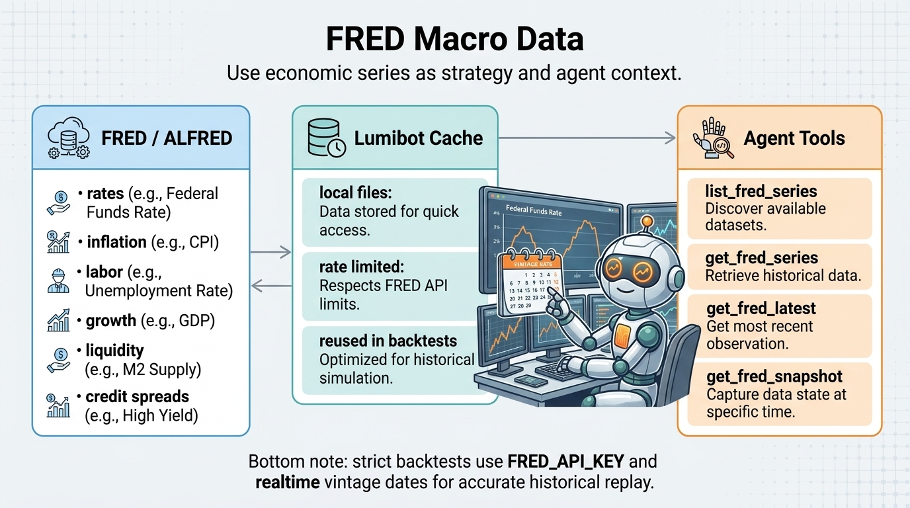

FRED Macro Data
===============

.. meta::
   :description: LumiBot includes native Federal Reserve Economic Data (FRED) macro tools for strategies and AI agents.

LumiBot includes native Federal Reserve Economic Data (FRED) macro tools for
strategies and AI agents. Use these tools for interest rates, inflation,
employment, growth, liquidity, credit spreads, and market-risk context.

Strategy API
------------

.. code-block:: python

   self.macro.list_series()
   self.macro.get_series("DGS10")
   self.macro.get_latest("UNRATE")
   self.macro.get_snapshot(["FEDFUNDS", "DGS10", "CPIAUCSL", "UNRATE"])

Agent Tools
-----------

Agents receive these built-ins automatically:

- ``list_fred_series``
- ``get_fred_series``
- ``get_fred_latest``
- ``get_fred_snapshot``

These tools are available to read-only research agents and trading-enabled
portfolio agents. They do not submit, cancel, or modify orders.

API Key Behavior
----------------

``FRED_API_KEY`` is required for the official FRED/ALFRED API path and for
all macro data fetches. LumiBot uses the official API path instead of public
CSV fallbacks so tool output has a clear provenance and backtests can request
point-in-time vintage observations.

With a key, LumiBot passes ``realtime_start`` and ``realtime_end`` based on the
strategy datetime so the backtest sees the vintage observations that were
available at that time.

Built-in FRED agent tools are hidden during backtests unless ``FRED_API_KEY`` is
configured. This prevents agents from accidentally using macro data without a
point-in-time data contract in historical simulations.

Backtest Date Safety
--------------------

In a backtest, ``as_of`` defaults to ``self.get_datetime()``.

FRED vintages identify calendar dates, not intraday release instants. In a
backtest, the effective vintage and observation boundary are capped at the
previous completed day in America/Chicago, relative to the simulated clock.
Earlier explicit ``as_of`` dates remain earlier; future overrides cannot move
that boundary forward. Live requests keep their current-date behavior.

The response includes ``as_of_date``, ``temporal_policy`` and a timing limitation.
This conservative approximation prevents morning decisions from seeing a same-day
closing value, but may omit legitimate same-day releases. It does not verify exact
intraday publication timing; retain that limitation in research handoffs.

Cache
-----

FRED data is cached under ``~/.lumibot/cache/fred`` by default. Override this
with ``LUMIBOT_FRED_CACHE_DIR``.

See :doc:`standalone_components` for use in scripts and notebooks.
